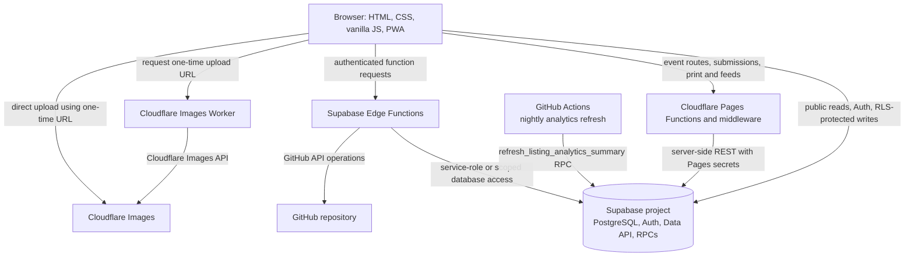

# The Greek Directory — Platform

> **Repository:** [`thegreekdirectory/platform`](https://github.com/thegreekdirectory/platform)  
> **Default branch:** `main`  
> **Related technical reference:** [Supabase implementation and database reference](./SUPABASE.md)

This repository contains the website and application code for **The Greek Directory**, a directory and discovery platform for Greek and Greek-affiliated businesses, organizations, churches, schools, services, and community events. It is a static-first web application with browser-side JavaScript, Cloudflare Pages Functions, Supabase, and Cloudflare Workers/Images integrations.

This document describes the repository as inspected on **November 3, 2026**. It distinguishes checked-in implementation from remote platform configuration that was not accessible during the audit.

## Contents

- [Project overview](#project-overview)
- [Verified capabilities](#verified-capabilities)
- [Architecture](#architecture)
- [Technology stack](#technology-stack)
- [Repository layout](#repository-layout)
- [Application and data flows](#application-and-data-flows)
- [Supabase integration](#supabase-integration)
- [Authentication and authorization](#authentication-and-authorization)
- [Configuration and secrets](#configuration-and-secrets)
- [Local development](#local-development)
- [Build and deployment](#build-and-deployment)
- [GitHub Actions](#github-actions)
- [Testing and validation](#testing-and-validation)
- [Security and operational notes](#security-and-operational-notes)
- [Troubleshooting](#troubleshooting)
- [Maintenance](#maintenance)
- [License and attribution](#license-and-attribution)

## Project overview

The application serves a public directory of Greek and Greek-affiliated listings. Its codebase includes the public directory, individual listing pages, map and category experiences, a business-owner portal, an administration interface, event discovery and submission, shortlinks, analytics, and Progressive Web App (PWA) support.

The repository is not a conventional single-page-app build. Most pages are HTML files, with page-specific JavaScript and shared CSS. Supabase supplies the application database, authentication, PostgREST API, RPCs, and serverless functions. Cloudflare Pages-style Functions handle server-side routes and privileged request flows. A separate Cloudflare Worker handles Cloudflare Images uploads.

## Verified capabilities

The following capabilities are represented in the current `main` branch source:

| Area | Implemented behavior |
|---|---|
| Public directory | Browse and search listings; filter by category and location; display listing details, contact information, hours, photos, video, social links, reviews, and custom calls to action. |
| Maps and location | Map and listing views, geolocation-related behavior, listing coordinates, and Google Place ID matching. |
| Listing relationships | Parent/child and chain-location support, plus listing shortlinks. |
| Business portal | Supabase email/password authentication, owner profile/contact management, listing editing, analytics display, and image/video upload flows. |
| Administration | Admin pages for listings, owners, requests, shortlinks, categories/subcategories, events, and analytics. The browser calls the `admin-proxy` Supabase Edge Function for privileged operations. |
| Events | Public event discovery, search and filtering, event detail pages, region pages, event submission and edit suggestions, event shortlinks, and calendar feeds/downloads (`.ics`). |
| Analytics | Listing action tracking, raw analytics records, a per-listing summary table, and a scheduled summary refresh workflow. |
| PWA | Web app manifests, service workers, offline page/support, and browser-side saved/starred experiences. |
| SEO and static output | Listing templates, generated listing pages, metadata/structured-data code, sitemap generators, redirects, and response headers. |
| Greek-owned Maps integration backend | Deployed Supabase functions and database objects for Place ID lookup, suggestion submission, and review. The Chrome extension itself is not present as a complete extension project in this repository. |

Feature availability is not the same as successful production operation. See [Security and operational notes](#security-and-operational-notes) and [the Supabase reference](./SUPABASE.md) for verified implementation gaps and live database findings.

## Architecture



### Hosting and runtime distinction

- The repository contains Cloudflare Pages Function conventions and routes under `functions/`, plus `_headers` and `_redirects` files. This confirms that the source is designed for a Cloudflare Pages-style runtime.
- The connected GitHub repository reports GitHub Pages as disabled. GitHub Pages is **not** the verified hosting target.
- The Cloudflare Pages account/project settings, production branch, custom-domain bindings, build configuration, and deployment history were not available through the connected integrations. Consequently, the live Cloudflare deployment cannot be independently certified from this audit.
- The root `CNAME` file contains `branch.thegreekdirectory.org`. Treat that as a repository configuration artifact, not proof of which domain is currently serving the project.

## Technology stack

| Layer | Verified technology |
|---|---|
| Frontend | HTML, CSS, browser JavaScript; no checked-in React, Vue, Angular, or TypeScript application build. |
| CSS build | Tailwind CSS CLI `^4.2.2`, with `@tailwindcss/cli` `^4.2.2`. |
| Browser Supabase client | Supabase JavaScript client v2 loaded by the site; the project URL and public anon key are embedded in browser-facing code. |
| Database/backend | Supabase PostgreSQL, Auth, PostgREST, SQL functions/RPCs, and Supabase Edge Functions. |
| Server-side web runtime | Cloudflare Pages Functions and middleware under `functions/`. |
| Image upload | Cloudflare Worker and Cloudflare Images Direct Creator Upload flow. |
| Scheduled task | GitHub Actions workflow calling a Supabase RPC. |
| Edge Function runtime | Deno-based Supabase Edge Functions. |

The checked-in `package.json` contains only the Tailwind build/watch scripts and the Tailwind CLI dependencies. The lockfile is committed. Other browser libraries are loaded by page markup or remote endpoints rather than declared as npm dependencies.

## Repository layout

The repository tree was enumerated recursively. The following is a functional map of the important source areas; generated pages and static assets are intentionally summarized rather than listed individually.

```text
.
├── .github/
│   └── workflows/
│       └── refresh-analytics-summary.yml
├── assets/                         # Static image and visual assets
├── cloudflare/
│   └── tgd-images-upload.js         # Cloudflare Images upload Worker source
├── css/                            # Site, portal, and page stylesheets
├── functions/                      # Cloudflare Pages Functions and middleware
│   ├── _middleware.js
│   ├── edit/                        # Event edit-suggestion route
│   ├── event/                       # Event detail and single-event ICS routes
│   ├── events/                      # Events index, regions, feeds, shared helpers
│   ├── print/                       # Listing print/PDF route
│   └── submit/                       # Event submission route
├── images/                          # Static image assets
├── js/                              # Browser application code
│   ├── pwa/                         # PWA-related modules
│   ├── admin.js                     # Administration interface logic
│   ├── admin-events.js              # Event administration logic
│   ├── business-auth.js             # Business portal auth/session UI
│   ├── business-dashboard.js        # Business-owner dashboard
│   ├── events.js                    # Public events client
│   ├── listing-page.js               # Individual listing page behavior
│   ├── listings.js                  # Public directory behavior
│   └── supabase-config.js           # Shared Supabase Auth/client helpers
├── listing/                         # Generated individual listing HTML pages
├── partials/                        # Shared header/footer HTML partials
├── scripts/
│   └── build-tailwind-output.js     # Tailwind CSS build script
├── src/                              # Tailwind source and generated CSS output
├── supabase/
│   ├── edge-functions/              # Checked-in reference copies of some functions
│   └── sql/                         # SQL scripts/data artifacts, not full migrations
├── widgets/                          # Reusable page/widget assets
├── index.html                        # Main public landing page
├── listings.html                     # Public directory page
├── listing-template.html             # Listing page template
├── events.html                       # Events page shell
├── business.html                     # Business portal shell
├── admin.html                        # Admin portal shell
├── manifest.json                     # Public PWA manifest
├── business-manifest.json            # Business portal PWA manifest
├── service-worker.js                 # Public-site service worker
├── business-sw.js                    # Business portal service worker
├── _headers                          # Hosting response-header rules
├── _redirects                        # Hosting redirect rules
├── generate-sitemap.js               # Listing/general sitemap generation
├── generate-events-sitemap.js        # Event sitemap generation
├── package.json
├── package-lock.json
├── README.md
└── SUPABASE.md
```

Other root HTML files provide pages such as `about.html`, `categories.html`, `map.html`, `submit-listing.html`, `suggest-edit.html`, `settings.html`, `tiers.html`, `offline.html`, `reserved.html`, and `404.html`. XML sitemap files and `listings-database.json` are checked in as static/generated data artifacts.

### Generated and non-source content

The `listing/` directory contains generated per-listing HTML pages. Static images, icons, logos, favicons, sitemap outputs, and package-lock metadata are not application source code in the same sense as the editable scripts. They were inventoried but were not individually reverse-engineered as code.

## Application and data flows

### Public directory

1. The browser loads static HTML/CSS/JS.
2. Frontend scripts initialize the Supabase JavaScript client using the public project URL and anon key.
3. Public data is read through the Supabase Data API and RPCs.
4. PostgreSQL grants and RLS policies constrain the rows visible to the `anon` role.
5. Listing-specific browser code renders detail pages, hours/status, maps, galleries, social links, and other listing fields.

### Business-owner portal

1. The portal uses the shared `TGDAuth` helpers in `js/supabase-config.js` and the UI/session code in `js/business-auth.js`.
2. It uses Supabase email/password Auth and maps the authenticated user to `public.business_owners` and `public.listings`.
3. The current `js/business-dashboard.js` code reads and updates `listings` through the browser Supabase client; the database's `tgd_listings_update` policy is therefore an important authorization boundary.
4. Media upload requests go to the Cloudflare Images Worker to request a one-time upload URL; the browser then uploads directly to Cloudflare Images.

A deployed `update-listing-bp` Edge Function also implements JWT validation, owner verification, and field allowlists, but the current browser dashboard source does not reference that function. Do not assume it is the active owner-write path without changing or tracing the frontend.

### Administration

1. `js/admin.js` obtains a GitHub token from the admin UI and stores it in browser `localStorage` under `tgd_admin_token`.
2. Requests are sent to the deployed `admin-proxy` Edge Function with the `x-github-token` header.
3. The Edge Function creates a Supabase service-role client and performs privileged operations for supported actions.

**Security warning:** the deployed `admin-proxy` has JWT verification disabled and its current custom check only tests whether GitHub's repository metadata endpoint returns a successful response. It does not verify the caller's GitHub identity or `permissions.push`/`admin`. A successful repository read is not an adequate admin authorization check for a service-role API. See [the Supabase security section](./SUPABASE.md#edge-function-authorization-findings).

### Events

- `js/events.js` loads public events in the browser using the anon key and the event RPCs.
- Cloudflare Pages Functions serve event index/region/detail routes, ICS endpoints, event submission, and event edit suggestions.
- Event submission and edit-suggestion server routes use `SUPABASE_SERVICE_ROLE_KEY`, because the corresponding intake tables do not grant public insert policies.
- Admin event CRUD is handled through `admin-proxy` actions.

### Analytics

- Browser interactions insert permitted raw actions into `public.listing_analytics`.
- The `trg_after_analytics_insert` trigger calls `increment_listing_analytics()` to update the per-listing summary row.
- The GitHub Actions workflow also calls `refresh_listing_analytics_summary()` on a daily schedule to recompute the summary from raw event records.

## Supabase integration

The connected Supabase project is `luetekzqrrgdxtopzvqw`, with project URL:

```text
https://luetekzqrrgdxtopzvqw.supabase.co
```

The current live database has the application tables, views, policies, triggers, and RPCs documented in [SUPABASE.md](./SUPABASE.md). That document is the detailed reference for:

- the live `public` schema and all 16 application tables;
- the `shortlink_event_summary` view;
- RLS policies and grants;
- database functions, triggers, constraints, indexes, and extensions;
- the 59 live migration-history entries;
- the eight deployed Edge Functions and their JWT-verification settings;
- security/performance advisor findings; and
- differences between live Supabase state and files checked into this repository.

The Supabase repository folder is **not** a complete source-of-truth migration history. There is no `supabase/migrations/` directory or `supabase/config.toml` in the inspected tree.

## Authentication and authorization

### Business-owner authentication

`js/supabase-config.js` wraps Supabase Auth operations for the portal, including account creation, password sign-in, sign-out, session/user lookup, password reset/update, and auth-state notifications. The implementation uses email/password flows and the production site URL for relevant confirmation/recovery redirects.

The database links a business owner to a listing through `public.business_owners.listing_id`. Listing access is enforced by RLS policies that reference the current JWT and owner information. Exact policy expressions are in [SUPABASE.md](./SUPABASE.md#row-level-security-policies).

### Administrative access

The admin browser UI currently stores a GitHub token in `localStorage` and sends it to `admin-proxy`. This is a separate authorization mechanism from Supabase business-owner Auth and must not be interpreted as a normal authenticated-user RLS flow. The deployed Edge Function's validation is insufficient for privileged service-role operations; the current implementation requires a security review before the admin surface is considered safely protected.

## Configuration and secrets

There is no checked-in `.env`, `.dev.vars`, `wrangler.toml`, or Supabase `config.toml` in the audited tree. The following names are derived from source references; values must be configured in the relevant provider dashboard or secret store. **Never copy secret values into this repository or documentation.**

| Where | Variable/configuration | Purpose |
|---|---|---|
| Browser source | Supabase project URL and public anon key constants | Public client initialization. The anon key is intentionally browser-visible; RLS/grants must secure the database. |
| Supabase Edge Functions | `SUPABASE_URL` | Server-side project API URL. |
| Supabase Edge Functions | `SUPABASE_SERVICE_ROLE_KEY` | Privileged service-role access used by selected functions. Keep server-side only. |
| Supabase Edge Functions | `SUPABASE_ANON_KEY` | Used by `update-listing-bp` to verify a caller's JWT through `auth.getUser()`. |
| Supabase Edge Functions | `GITHUB_TOKEN` | Used by `update-github-file` for GitHub Contents API requests. |
| Cloudflare Pages Functions | `SUPABASE_SERVICE_ROLE_KEY` | Used by event submission/edit and server-rendered listing/event routes. |
| Cloudflare Pages Functions | `CLOUDFLARE_ACCOUNT_ID`, `CLOUDFLARE_API_TOKEN` | Used by the listing print/PDF Browser Rendering route. |
| Cloudflare Images Worker | `CLOUDFLARE_ACCOUNT_ID`, `CLOUDFLARE_IMAGES_API_TOKEN` | Creates Cloudflare Images upload URLs and performs server-side image API operations. |
| GitHub Actions | `SUPABASE_URL`, `SUPABASE_SERVICE_ROLE_KEY` | Used by the daily analytics-summary refresh workflow. |
| Admin browser | GitHub token entered through the admin UI | Stored in `localStorage` as `tgd_admin_token`; this is not a repository secret and has security implications. |

The production auth redirect URL is hard-coded in `js/supabase-config.js` as `https://thegreekdirectory.org`. Source comments state that preview `*.pages.dev` URLs are not currently on the Supabase Auth allowlist. Actual Auth dashboard provider, redirect, SMTP, and confirmation settings were not accessible in the connected Supabase interface.

## Local development

### Prerequisites

- Git
- Node.js and npm compatible with the committed `package-lock.json`
- Python 3 (only if using the simple static preview command below)

No Node `engines` range or repository-specific local runtime configuration was found.

### Install dependencies

```bash
npm ci
```

This installs the exact dependency versions represented by the committed lockfile.

### Build Tailwind CSS

```bash
npm run tailwind:build
```

This runs `scripts/build-tailwind-output.js` to regenerate the checked-in Tailwind output. Run it after changing Tailwind source or content classes that need to appear in the generated stylesheet.

For repeated rebuilds during CSS work:

```bash
npm run tailwind:watch
```

The watch script is a shell loop that re-runs the build approximately every two seconds; it is not a framework dev server.

### Static preview

From the repository root:

```bash
python3 -m http.server 8000
```

Then open `http://localhost:8000`.

This serves static files only. It does **not** execute Cloudflare Pages Functions, the Pages middleware, the Cloudflare Images Worker, or Supabase Edge Functions. Routes that depend on those server-side runtimes (for example, event submission, server-rendered event pages, ICS routes, and PDF generation) cannot be fully validated by this static server alone. No repository-local Cloudflare Pages dev script or Wrangler configuration was found, so a full local Functions environment is not preconfigured in this repository.

### Supabase connection

The browser client already points to the live project in the checked-in source. Do not use the live project as an unrestricted development database. A separate development project or controlled test environment is not documented in the repository. The Supabase Auth redirect allowlist may also prevent local callback/recovery flows until the dashboard configuration is deliberately updated.

## Build and deployment

### Verified build behavior

- The only npm build script is `tailwind:build`.
- The only other npm script is `tailwind:watch`.
- No application bundler, TypeScript compilation step, npm test command, npm lint command, or repository deployment script is defined in `package.json`.
- Static HTML, JavaScript, CSS, assets, generated listing pages, and sitemap files are checked into the repository.

### Hosting-related files

| File | Behavior |
|---|---|
| `functions/` | Cloudflare Pages Functions routes and middleware. |
| `_redirects` | Extensionless URL redirects, directory/map shortcuts, and reserved-path redirects. Event redirects in this file are commented out. |
| `_headers` | Sets `X-Robots-Tag: noindex, nofollow` globally and stricter directives for `/admin`. |
| `CNAME` | Contains `branch.thegreekdirectory.org`. |

**Important:** the global noindex header and branch-subdomain CNAME are environment-sensitive. Verify these before using the repository state for a public production deployment. GitHub's repository metadata reports `has_pages: false`; no GitHub Pages deployment is configured in the inspected settings.

### Cloudflare deployment limitations

The source code establishes Cloudflare Pages/Workers integration points, but the Cloudflare account's Pages project, connected GitHub branch, custom domains, build settings, environment variables, deployment history, and Worker route bindings could not be inspected. No deployment instructions are asserted here beyond the verified source/build behavior. Confirm the Cloudflare configuration in its dashboard before changing deployment settings.

## GitHub Actions

The repository contains one workflow:

**`.github/workflows/refresh-analytics-summary.yml` — Refresh Listing Analytics Summary**

- Scheduled for `0 0 * * *` (midnight UTC daily).
- Also supports `workflow_dispatch`.
- Sends an HTTP POST to the Supabase REST RPC `refresh_listing_analytics_summary`.
- Reads the GitHub Actions secrets `SUPABASE_URL` and `SUPABASE_SERVICE_ROLE_KEY`.
- Exits non-zero unless the response status is `200` or `204`.

No GitHub Actions workflow for building/deploying the website was found. Workflow run history and secret values were not accessible through the connected GitHub interface, so the workflow's recent success/failure status and the existence/configuration of its secrets could not be independently confirmed.

## Testing and validation

The inspected repository contains no discoverable automated test suite or root npm test/lint scripts. The Supabase project has live schema and advisor tooling, but no repository-managed `supabase/tests/` directory or checked-in pgTAP test suite was found.

Available validation paths evidenced by the source are:

- `npm run tailwind:build` for the CSS build;
- manual browser verification of static pages and Supabase client flows;
- Cloudflare Pages runtime verification for server-side routes;
- Supabase Edge Function invocation/log inspection;
- the scheduled analytics RPC workflow; and
- Supabase Security and Performance Advisors.

Do not treat the presence of a workflow or deployed function as proof that it is currently healthy. Review the provider's actual run logs and function logs when validating a deployment.

## Security and operational notes

The audit identified material issues that should be reviewed before treating all privileged paths as secure:

1. **Admin proxy authorization:** deployed `admin-proxy` has `verify_jwt = false`; its custom GitHub-token check only tests whether `GET /repos/thegreekdirectory/platform` succeeds. It does not check the authenticated GitHub user's identity or repository write/admin permissions before using the Supabase service-role key.
2. **GitHub token in browser storage:** `js/admin.js` stores the supplied GitHub token in `localStorage` (`tgd_admin_token`). A same-origin script injection could read it.
3. **GitHub file update endpoint:** deployed `update-github-file` has JWT verification enabled, but its source accepts `owner`, `repo`, `path`, `content`, and `message` from the request and uses a server-side `GITHUB_TOKEN`; no application admin/role authorization check was found in that function's source.
4. **Business-owner data read policy:** the `business_owners` SELECT policy includes an anonymous-access path for unclaimed owner records with a non-null `confirmation_key`. Because table SELECT privileges are granted to `anon`, verify that this does not expose claim keys, owner emails, or owner contact data beyond the intended claim flow.
5. **Public tracking data:** `listing_analytics` and `shortlink_events` have public SELECT policies. The latter includes IP address, user agent, approximate location, and event time fields; the former includes user-agent and interaction data.
6. **Owner hours update mismatch:** `js/business-dashboard.js` submits `hours_updated_at` and `hours_updated_by` when hours change, but those columns are absent from the live `public.listings` table. Those updates can fail when included in a PATCH.
7. **Static branch gate:** `functions/_middleware.js` contains a hard-coded gate value used with a query parameter/cookie and sets a one-year cookie. This is not a suitable substitute for a managed authentication/access-control mechanism.
8. **Noindex and branch domain:** `_headers` applies noindex/nofollow globally, and `CNAME` points to a branch subdomain. Verify that these are intentional for the environment.

The database-specific risks, stale RPCs, exposed `SECURITY DEFINER` functions, unindexed foreign keys, and other advisor findings are documented in [SUPABASE.md](./SUPABASE.md#security-and-advisor-findings).

## Troubleshooting

| Symptom | Likely investigation |
|---|---|
| CSS changes do not appear | Run `npm run tailwind:build`; confirm the generated stylesheet is the one linked by the page. |
| Static page works but a dynamic route returns a 404 | A basic static server does not execute `functions/`; verify the Cloudflare Pages route/runtime. |
| Event submission fails | Check the Pages Function secret `SUPABASE_SERVICE_ROLE_KEY`, `event_requests` schema/policies, and Pages Function logs. |
| Business-owner read/update returns an RLS error | Check the Auth session, matching `business_owners` row, the user's email/owner mapping, and `tgd_listings_update` policy. |
| Owner hours update fails | Check the submitted payload against live `public.listings` columns; `hours_updated_at` and `hours_updated_by` are not currently present. |
| Listing/event hours status differs by device | Verify the deployed `listing-server-time` Edge Function and the browser's call to it. |
| Admin requests return 401/403 | Verify the supplied GitHub token path, deployed Edge Function code, and repository permission model. Do not weaken auth to work around a failure. |
| Image upload fails | Verify the Cloudflare Worker route and `CLOUDFLARE_ACCOUNT_ID` / `CLOUDFLARE_IMAGES_API_TOKEN` secrets. |
| Analytics summary is stale | Inspect the GitHub Actions run and the Supabase RPC logs for `refresh_listing_analytics_summary`. |

## Maintenance

- Treat the live Supabase schema and deployed Edge Functions as separate deployable resources; their code is not guaranteed to match the repository mirror.
- Before database changes, export the current schema and reconcile the 59 live migration-history entries with a proper repository migration history.
- Do not apply the `supabase/sql/listings_rows.sql` file as a schema migration; it is a large data artifact.
- Review generated listing pages and sitemap outputs after changing templates or generators.
- Rebuild Tailwind output after class/source changes.
- Recheck Cloudflare environment secrets and routes after modifying Pages Functions or the Images Worker.
- Keep service-role keys and GitHub tokens in provider secret stores only.
- Re-run Supabase Security and Performance Advisors after schema/security changes.

## License and attribution

No `LICENSE` file or GitHub license metadata was present in the inspected repository. Source files contain proprietary/copyright notices, but no formal repository license was verified. Do not assume that the code is open source or that third parties have redistribution rights.
