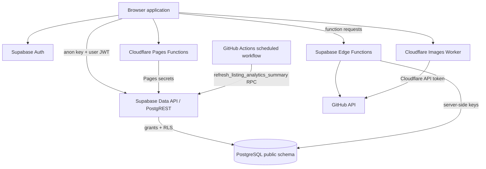
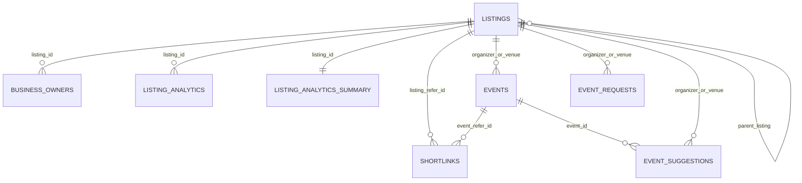

# Supabase Implementation Reference — The Greek Directory

> **Project reference:** `luetekzqrrgdxtopzvqw`  
> **Project URL:** `https://luetekzqrrgdxtopzvqw.supabase.co`  
> **Repository:** [`thegreekdirectory/platform`](https://github.com/thegreekdirectory/platform)  
> **Audit snapshot:** November 3, 2026  
> **Companion document:** [README.md](./README.md)

This document describes the live Supabase database and deployed Edge Functions as inspected for the repository audit. It is a snapshot, not a promise that the database will remain unchanged. Where live project settings were not exposed by the connected integrations, the limitation is stated explicitly.

## 1. Scope, evidence, and limitations

### Inspected

- Live Supabase project metadata and project URL.
- The live `public` schema: tables, views, columns, defaults, nullability, primary keys, foreign keys, unique/check constraints, indexes, row counts, and RLS policies.
- Public-schema PostgreSQL functions, signatures, return types, language, security mode, `search_path`, and execute privileges for `anon`, `authenticated`, and `service_role`.
- Table triggers and database event triggers.
- Installed PostgreSQL extensions.
- Supabase migration-history entries.
- Deployed Edge Function names, versions, `verify_jwt` settings, and function source.
- Security and Performance Advisor findings.
- Repository migrations/SQL files and the application call sites that use Supabase.
- Storage bucket metadata, storage policies, PostgreSQL publication membership, and presence/absence of the `cron.job` catalog.

### Not accessible or not confirmed

| Area | Audit limitation |
|---|---|
| Auth dashboard configuration | The connected project metadata did not expose enabled Auth providers, email-confirmation settings, password policy configuration beyond the leaked-password advisor, SMTP settings, email templates, or the complete redirect allowlist. |
| Secret values | Secret values were not read or reproduced. Environment-variable names were inferred only from checked-in or deployed source references. |
| Cloudflare Pages | Pages project settings, binding values, active custom domains, deployment branch, build settings, deployment history, and runtime secrets were not accessible through the connected integrations. |
| GitHub Actions state | The workflow source is available, but run history and configured secret existence/values could not be confirmed. |
| Migration SQL | The live migration versions/names were retrievable, but the SQL body for each applied migration was not exposed as part of the migration-list response. |
| Non-public/system schemas | Supabase-managed schemas and internal objects were not treated as application-owned schema. The detailed inventory below focuses on `public` plus the relevant Storage, Realtime, Auth, and extension observations. |
| Auth user records | User-level Auth records were not enumerated; they are not needed to describe the application schema and should not be exposed in documentation. |

The repository's checked-in migrations are incomplete: there is no `supabase/migrations/` directory or `supabase/config.toml`. Therefore, the live schema and live migration-history response—not the SQL folder—are the source of truth for the schema snapshot in this document.

## 2. Project overview

| Property | Observed value |
|---|---|
| Project reference | `luetekzqrrgdxtopzvqw` |
| API URL | `https://luetekzqrrgdxtopzvqw.supabase.co` |
| Project status | `ACTIVE` |
| Region | `us-west-2` |
| PostgreSQL version | `17.6.1.063` |
| Project creation date | January 13, 2026 |
| Application schema | `public` |
| Live migration history | 59 entries, from `20260309054108` through `20261031054358` |
| Deployed Edge Functions | 8 active functions |
| Installed extensions | 7, including `plpgsql` |

### Supabase's role in the application

Supabase provides:

- PostgreSQL storage for listings, business owners, event records, requests, suggestions, shortlinks, and analytics;
- Supabase Auth for business-owner email/password sessions;
- the PostgREST Data API for browser reads and selected browser writes;
- SQL functions/RPCs used by public directory/event views and analytics;
- Edge Functions for server-side operations and integrations; and
- the service-role access used by selected Cloudflare Pages Functions and Edge Functions.

Supabase Storage buckets are not used in the current live project snapshot. Listing media uploads use Cloudflare Images instead.

## 3. Architecture and request flows



### 3.1 Browser client

`js/supabase-config.js` initializes the Supabase JavaScript client using the hard-coded project URL and public anon key. Other browser files also initialize Supabase clients or call the REST API directly. The key used in browser code is a public anon key; it is not a service-role key. It must be protected by RLS and appropriately scoped grants.

Observed browser call patterns include:

- direct queries to `listings`, `business_owners`, `category_subcategories`, `listing_analytics`, and `listing_analytics_summary`;
- public event RPCs such as `get_upcoming_events` and `get_events_by_cities`;
- Supabase Auth methods for registration, sign-in, sign-out, password reset/update, current session/user lookup, and auth-state changes; and
- direct PostgREST listing updates from the business dashboard, relying on RLS.

### 3.2 Business-owner authentication and data access

The portal uses Supabase email/password Auth. `public.business_owners` connects the Auth identity/email to `public.listings` through `listing_id`. Current `js/business-dashboard.js` code performs direct browser-side listing reads and updates. The active owner authorization boundary is therefore the table grants and the `tgd_listings_select` / `tgd_listings_update` policies.

The deployed `update-listing-bp` Edge Function separately implements a server-side owner check and allowlists for listing and owner updates. A repository-wide search found no call site from the current browser dashboard for this function; do not describe it as the active portal write path without changing or tracing the frontend.

### 3.3 Admin access

The admin UI (`js/admin.js`) sends an `x-github-token` header to the `admin-proxy` Edge Function. That function creates a Supabase service-role client and supports privileged operations on listings, events, owners, requests, analytics, categories/subcategories, and shortlinks.

**This authorization implementation is not adequate for a service-role CRUD proxy:** the deployed function disables platform JWT verification and tests only whether GitHub's repository-metadata API request succeeds. It does not verify the caller's GitHub identity or require repository write/admin permissions. See [Edge Function authorization findings](#edge-function-authorization-findings).

### 3.4 Event submission and event suggestions

`functions/submit/event.js` and `functions/edit/event.js` are Cloudflare Pages Functions, not Supabase Edge Functions. They use the Pages runtime's `SUPABASE_SERVICE_ROLE_KEY` to insert into `event_requests` and `event_suggestions`. Those intake tables do not have public insert policies, so the server-side Pages Functions are the observed write path.

### 3.5 Analytics refresh

A database trigger updates `listing_analytics_summary` after inserts into `listing_analytics`. A GitHub Actions workflow also runs daily at midnight UTC and calls the `refresh_listing_analytics_summary()` RPC through PostgREST. There is no live `pg_cron` job catalog in this project snapshot.

## 4. Database inventory

### 4.1 Public relations and approximate row counts

Counts below are the live table counts returned during the audit; treat them as a point-in-time snapshot.

| Relation | Kind | Rows | RLS |
|---|---|---:|---|
| `business_owners` | Table | 155 | Enabled |
| `category_subcategories` | Table | 14 | Enabled |
| `event_category_subcategories` | Table | 8 | Enabled |
| `event_requests` | Table | 0 | Enabled |
| `event_suggestions` | Table | 0 | Enabled |
| `events` | Table | 17 | Enabled |
| `greek_owned_extension_rate_limits` | Table | 2 | Enabled |
| `greek_owned_extension_suggestions` | Table | 1 | Enabled |
| `listing_analytics` | Table | 2,027 | Enabled |
| `listing_analytics_summary` | Table | 155 | Enabled |
| `listing_requests` | Table | 0 | Enabled |
| `listing_suggestions` | Table | 1 | Enabled |
| `listings` | Table | 155 | Enabled |
| `listings_hours_backup` | Table | 155 | Enabled |
| `shortlink_events` | Table | 103 | Enabled |
| `shortlinks` | Table | 541 | Enabled |
| `shortlink_event_summary` | View | — | View; not an RLS table |

All 16 application tables in `public` have RLS enabled. None was observed with `FORCE ROW LEVEL SECURITY`. Three application tables have no RLS policies at all; see [RLS inventory](#row-level-security-policies).

### 4.2 Relationship diagram



`listings_hours_backup.listing_id` has no foreign key in the live schema. The two Greek-owned extension tables are operational tables accessed by the related Edge Functions and have no foreign keys to listings.

## 5. Tables and views: complete column reference

Notation used below:

- `NOT NULL` means the live column is non-nullable.
- `DEFAULT ...` is the observed PostgreSQL default.
- Columns not marked `NOT NULL` are nullable.
- `identity` indicates a PostgreSQL identity-generated ID. Sequence-backed defaults are shown explicitly where applicable.
- JSON/array columns are stored as `jsonb`, `jsonb[]`, `text[]`, or `jsonb[]` exactly as indicated.

### 5.1 `public.listings`

Purpose: canonical business/organization listing records displayed by the public directory and edited by administrators or authorized owners. Primary key: `id`. Unique constraint: `slug`.

| Column | Type | Nullability / default |
|---|---|---|
| `slug` | `text` | NOT NULL |
| `business_name` | `text` | NOT NULL |
| `tagline` | `text` | nullable |
| `description` | `text` | nullable |
| `category` | `text` | NOT NULL |
| `subcategories` | `text[]` | nullable; DEFAULT `'{}'::text[]` |
| `primary_subcategory` | `text` | nullable |
| `tier` | `text` | nullable; DEFAULT `'FREE'::text`; CHECK `FREE`, `VERIFIED`, `FEATURED`, `PREMIUM` |
| `verified` | `boolean` | nullable; DEFAULT `false` |
| `visible` | `boolean` | nullable; DEFAULT `true` |
| `is_chain` | `boolean` | nullable; DEFAULT `false` |
| `chain_name` | `text` | nullable |
| `chain_id` | `text` | nullable |
| `address` | `text` | nullable |
| `city` | `text` | nullable |
| `state` | `text` | nullable |
| `zip_code` | `text` | nullable |
| `country` | `text` | nullable; DEFAULT `'USA'::text` |
| `coordinates` | `jsonb` | nullable |
| `places_url_ending` | `text[]` | nullable; DEFAULT `'{}'::text[]` |
| `phone` | `text` | nullable |
| `email` | `text` | nullable |
| `website` | `text` | nullable |
| `hours` | `jsonb` | nullable; DEFAULT `'{}'::jsonb` |
| `social_media` | `jsonb` | nullable; DEFAULT `'{}'::jsonb` |
| `reviews` | `jsonb` | nullable; DEFAULT `'{}'::jsonb` |
| `logo` | `text` | nullable |
| `photos` | `text[]` | nullable; DEFAULT `'{}'::text[]` |
| `video` | `text` | nullable |
| `meta_description` | `text` | nullable |
| `created_at` | `timestamptz` | nullable; DEFAULT `now()` |
| `updated_at` | `timestamptz` | nullable; DEFAULT `now()` |
| `is_claimed` | `boolean` | nullable; DEFAULT `false` |
| `additional_info` | `jsonb` | nullable; DEFAULT `'[]'::jsonb` |
| `custom_ctas` | `jsonb` | nullable; DEFAULT `'[]'::jsonb` |
| `pricing` | `smallint` | nullable |
| `coming_soon` | `boolean` | NOT NULL; DEFAULT `false` |
| `id` | `uuid` | NOT NULL; DEFAULT `gen_random_uuid()`; primary key |
| `timezone` | `text` | NOT NULL; DEFAULT `'America/Chicago'::text`; timezone-format CHECK |
| `hours_label_custom` | `text` | nullable |
| `hours_disclaimer_custom` | `text` | nullable |
| `custom_schema_properties` | `text` | nullable |
| `updated_by_role` | `text` | nullable |
| `temporarily_closed` | `boolean` | NOT NULL; DEFAULT `false` |
| `permanently_closed` | `boolean` | NOT NULL; DEFAULT `false` |
| `more_listings_title_custom` | `text` | nullable |
| `parent_listing` | `uuid` | nullable; self-FK to `listings.id` |
| `parent_listing_title_custom` | `text` | nullable |
| `child_listings_custom_title` | `text` | nullable |
| `version` | `integer` | NOT NULL; DEFAULT `1`; CHECK `version > 0` |
| `google_place_id` | `text` | nullable |

**Important source/schema mismatch:** `js/business-dashboard.js` includes `hours_updated_at` and `hours_updated_by` in its update payload when business hours change. Neither column exists in the live `public.listings` definition. A PATCH containing either unknown field can fail at the Data API layer. The deployed `update-listing-bp` allowlist also names these fields, but the live table does not contain them.

### 5.2 `public.business_owners`

Purpose: owner/contact record associated with a listing. Primary key: `id`; unique constraint: `owner_user_id`; `listing_id` references `listings.id` with `ON DELETE CASCADE`.

| Column | Type | Nullability / default |
|---|---|---|
| `id` | `bigint` | NOT NULL; `nextval('business_owners_id_seq'::regclass)`; primary key |
| `full_name` | `text` | nullable |
| `title` | `text` | nullable |
| `from_greece` | `text` | nullable |
| `owner_email` | `text` | nullable |
| `owner_phone` | `text` | nullable |
| `owner_user_id` | `text` | nullable; UNIQUE |
| `confirmation_key` | `text` | nullable |
| `created_at` | `timestamptz` | nullable; DEFAULT `now()` |
| `updated_at` | `timestamptz` | nullable; DEFAULT `now()` |
| `name_title_visible` | `boolean` | NOT NULL; DEFAULT `true` |
| `owner_email_visible` | `boolean` | NOT NULL; DEFAULT `true` |
| `claim_attempts` | `integer` | NOT NULL; DEFAULT `0` |
| `claim_locked_until` | `timestamptz` | nullable |
| `listing_id` | `uuid` | NOT NULL; FK to `listings.id` |
| `email_visible` | `boolean` | nullable |
| `phone_visible` | `boolean` | nullable |

### 5.3 `public.listing_analytics`

Purpose: raw listing interaction records. Primary key: `id`; `listing_id` references `listings.id` with `ON DELETE CASCADE`.

| Column | Type | Nullability / default |
|---|---|---|
| `id` | `bigint` | NOT NULL; `nextval('listing_analytics_id_seq'::regclass)`; primary key |
| `action` | `text` | NOT NULL |
| `platform` | `text` | nullable |
| `timestamp` | `timestamptz` | nullable; DEFAULT `now()` |
| `user_agent` | `text` | nullable |
| `created_at` | `timestamptz` | nullable; DEFAULT `now()` |
| `listing_id` | `uuid` | NOT NULL; FK to `listings.id` |

### 5.4 `public.listing_analytics_summary`

Purpose: per-listing aggregate interaction counters. Primary key and foreign key: `listing_id`, referencing `listings.id` with `ON DELETE CASCADE`.

| Column group | Type | Nullability / default |
|---|---|---|
| `listing_id` | `uuid` | NOT NULL; primary key and FK to `listings.id` |
| Each counter listed below | `integer` | NOT NULL; DEFAULT `0` |
| `updated_at` | `timestamptz` | nullable; DEFAULT `now()` |

The following 10 counter prefixes each expand to **eight separate columns** using the suffixes `{7d, 14d, 1m, 3m, 6m, 1y, 2y, all}`. This notation specifies every one of the 80 counter columns:

- `views_{7d,14d,1m,3m,6m,1y,2y,all}`
- `call_clicks_{7d,14d,1m,3m,6m,1y,2y,all}`
- `email_clicks_{7d,14d,1m,3m,6m,1y,2y,all}`
- `website_clicks_{7d,14d,1m,3m,6m,1y,2y,all}`
- `directions_clicks_{7d,14d,1m,3m,6m,1y,2y,all}`
- `custom_cta_1_{7d,14d,1m,3m,6m,1y,2y,all}`
- `custom_cta_2_{7d,14d,1m,3m,6m,1y,2y,all}`
- `share_clicks_{7d,14d,1m,3m,6m,1y,2y,all}`
- `social_clicks_{7d,14d,1m,3m,6m,1y,2y,all}`
- `review_clicks_{7d,14d,1m,3m,6m,1y,2y,all}`

The table has 82 columns total: `listing_id`, the 80 counters above, and `updated_at`.

### 5.5 `public.listing_requests`

Purpose: public listing submissions awaiting administrative review. Primary key: `id` (identity). Public INSERT is allowed through an RLS policy; reads/updates/deletes are admin-only.

| Column | Type | Nullability / default |
|---|---|---|
| `id` | `bigint` | NOT NULL; identity |
| `created_at` | `timestamptz` | NOT NULL; DEFAULT `now()` |
| `updated_at` | `timestamptz` | NOT NULL; DEFAULT `now()` |
| `business_name` | `text` | NOT NULL |
| `slug` | `text` | nullable |
| `tagline` | `text` | NOT NULL |
| `description` | `text` | NOT NULL |
| `category` | `text` | NOT NULL |
| `subcategories` | `text[]` | NOT NULL; DEFAULT `'{}'::text[]` |
| `primary_subcategory` | `text` | nullable |
| `is_chain` | `boolean` | NOT NULL; DEFAULT `false` |
| `chain_name` | `text` | nullable |
| `chain_id` | `text` | nullable |
| `address` | `text` | nullable |
| `city` | `text` | nullable |
| `state` | `text` | nullable |
| `zip_code` | `text` | nullable |
| `country` | `text` | nullable; DEFAULT `'USA'::text` |
| `phone` | `text` | nullable |
| `email` | `text` | nullable |
| `website` | `text` | nullable |
| `logo` | `text` | nullable |
| `photos` | `text[]` | nullable; DEFAULT `'{}'::text[]` |
| `video` | `text` | nullable |
| `hours` | `jsonb` | nullable; DEFAULT `'{}'::jsonb` |
| `social_media` | `jsonb` | nullable; DEFAULT `'{}'::jsonb` |
| `reviews` | `jsonb` | nullable; DEFAULT `'{}'::jsonb` |
| `additional_info` | `jsonb` | nullable; DEFAULT `'[]'::jsonb` |
| `custom_ctas` | `jsonb` | nullable; DEFAULT `'[]'::jsonb` |
| `owner_name` | `text` | nullable |
| `owner_title` | `text` | nullable |
| `from_greece` | `text` | nullable |
| `owner_email` | `text` | nullable |
| `owner_phone` | `text` | nullable |
| `owner_name_title_visible` | `boolean` | NOT NULL; DEFAULT `true` |
| `owner_email_visible` | `boolean` | NOT NULL; DEFAULT `false` |
| `owner_phone_visible` | `boolean` | NOT NULL; DEFAULT `false` |
| `owner_contacts` | `jsonb` | nullable; DEFAULT `'[]'::jsonb` |

### 5.6 `public.listing_suggestions`

Purpose: suggestions or proposed corrections to an existing listing. Primary key: `id`.

| Column | Type | Nullability / default |
|---|---|---|
| `id` | `bigint` | NOT NULL; `nextval('listing_suggestions_id_seq'::regclass)`; primary key |
| `listing_id` | `text` | NOT NULL |
| `listing_name` | `text` | nullable |
| `suggester_name` | `text` | NOT NULL |
| `suggester_email` | `text` | NOT NULL |
| `suggester_phone` | `text` | nullable |
| `suggester_message` | `text` | nullable |
| `status` | `text` | NOT NULL; DEFAULT `'pending'::text` |
| `business_name` | `text` | nullable |
| `tagline` | `text` | nullable |
| `description` | `text` | nullable |
| `category` | `text` | nullable |
| `subcategories` | `text[]` | nullable |
| `primary_subcategory` | `text` | nullable |
| `pricing` | `integer` | nullable |
| `coming_soon` | `boolean` | nullable |
| `address` | `text` | nullable |
| `city` | `text` | nullable |
| `state` | `text` | nullable |
| `zip_code` | `text` | nullable |
| `country` | `text` | nullable |
| `phone` | `text` | nullable |
| `email` | `text` | nullable |
| `website` | `text` | nullable |
| `logo` | `text` | nullable |
| `photos` | `text[]` | nullable |
| `video` | `text` | nullable |
| `hours` | `jsonb` | nullable |
| `social_media` | `jsonb` | nullable |
| `reviews` | `jsonb` | nullable |
| `additional_info` | `jsonb[]` | nullable |
| `custom_ctas` | `jsonb[]` | nullable |
| `owner_name` | `text` | nullable |
| `owner_title` | `text` | nullable |
| `from_greece` | `text` | nullable |
| `owner_email` | `text` | nullable |
| `owner_phone` | `text` | nullable |
| `owner_name_title_visible` | `boolean` | nullable |
| `owner_email_visible` | `boolean` | nullable |
| `owner_phone_visible` | `boolean` | nullable |
| `owner_contacts` | `jsonb[]` | nullable |
| `created_at` | `timestamptz` | NOT NULL; DEFAULT `now()` |

### 5.7 `public.category_subcategories`

Purpose: listing category lookup and category-to-subcategory/schema-type metadata. Primary key: `category`.

| Column | Type | Nullability / default |
|---|---|---|
| `category` | `text` | NOT NULL; primary key |
| `subcategories` | `text[]` | NOT NULL; DEFAULT `'{}'::text[]` |
| `schema_type_map` | `jsonb` | NOT NULL; DEFAULT `'{}'::jsonb` |

### 5.8 `public.events`

Purpose: published public/community events. Primary key: `id`; unique constraint: `slug`; organizer and venue references point to listings.

| Column | Type | Nullability / default |
|---|---|---|
| `id` | `uuid` | NOT NULL; DEFAULT `gen_random_uuid()`; primary key |
| `slug` | `text` | NOT NULL; UNIQUE |
| `title` | `text` | NOT NULL |
| `tagline` | `text` | nullable |
| `description` | `text` | nullable |
| `category` | `text` | nullable |
| `subcategories` | `text[]` | nullable; DEFAULT `'{}'::text[]` |
| `organizer_listing_id` | `uuid` | nullable; FK to `listings.id` ON DELETE SET NULL |
| `venue_listing_id` | `uuid` | nullable; FK to `listings.id` ON DELETE SET NULL |
| `custom_venue_name` | `text` | nullable |
| `start_at` | `timestamptz` | NOT NULL |
| `end_at` | `timestamptz` | nullable; CHECK `end_at IS NULL OR end_at >= start_at` |
| `timezone` | `text` | NOT NULL; DEFAULT `'America/Chicago'::text`; timezone-format CHECK |
| `all_day` | `boolean` | NOT NULL; DEFAULT `false` |
| `recurrence` | `jsonb` | NOT NULL; DEFAULT `'{}'::jsonb` |
| `city` | `text` | nullable |
| `state` | `text` | nullable |
| `zip_code` | `text` | nullable |
| `coordinates` | `jsonb` | nullable |
| `poster_image` | `text` | nullable |
| `video` | `text` | nullable |
| `is_free` | `boolean` | NOT NULL; DEFAULT `true` |
| `price_range` | `text` | nullable |
| `ticket_url` | `text` | nullable |
| `rsvp_required` | `boolean` | NOT NULL; DEFAULT `false` |
| `rsvp_url` | `text` | nullable |
| `capacity` | `integer` | nullable |
| `registered_count` | `integer` | NOT NULL; DEFAULT `0` |
| `contact_phone` | `text` | nullable |
| `contact_email` | `text` | nullable |
| `website` | `text` | nullable |
| `social_media` | `jsonb` | NOT NULL; DEFAULT `'{}'::jsonb` |
| `status` | `text` | NOT NULL; DEFAULT `'scheduled'::text`; CHECK `scheduled`, `cancelled`, `postponed`, `sold_out` |
| `tier` | `text` | nullable; DEFAULT `'FREE'::text`; CHECK `FREE`, `FEATURED`, `PREMIUM` |
| `visible` | `boolean` | NOT NULL; DEFAULT `true` |
| `is_claimed` | `boolean` | NOT NULL; DEFAULT `false` |
| `additional_info` | `jsonb` | NOT NULL; DEFAULT `'[]'::jsonb` |
| `custom_ctas` | `jsonb` | NOT NULL; DEFAULT `'[]'::jsonb` |
| `custom_schema_properties` | `text` | nullable |
| `meta_description` | `text` | nullable |
| `updated_by_role` | `text` | nullable |
| `created_at` | `timestamptz` | nullable; DEFAULT `now()` |
| `updated_at` | `timestamptz` | nullable; DEFAULT `now()` |
| `address` | `text` | nullable |
| `gallery` | `jsonb` | NOT NULL; DEFAULT `'[]'::jsonb` |
| `country` | `text` | nullable |

### 5.9 `public.event_category_subcategories`

Purpose: event category-to-subcategory lookup. Primary key: `category`.

| Column | Type | Nullability / default |
|---|---|---|
| `category` | `text` | NOT NULL; primary key |
| `subcategories` | `text[]` | NOT NULL; DEFAULT `'{}'::text[]` |

### 5.10 `public.event_requests`

Purpose: new event submissions awaiting review. Primary key: `id` (identity). Organizer/venue FKs point to `listings.id` with `ON DELETE SET NULL`. Status CHECK: `pending`, `approved`, `rejected`.

| Column | Type | Nullability / default |
|---|---|---|
| `id` | `bigint` | NOT NULL; identity; primary key |
| `created_at` | `timestamptz` | NOT NULL; DEFAULT `now()` |
| `updated_at` | `timestamptz` | NOT NULL; DEFAULT `now()` |
| `status` | `text` | NOT NULL; DEFAULT `'pending'::text`; status CHECK |
| `title` | `text` | NOT NULL |
| `slug` | `text` | nullable |
| `tagline` | `text` | nullable |
| `description` | `text` | nullable |
| `category` | `text` | nullable |
| `subcategories` | `text[]` | nullable; DEFAULT `'{}'::text[]` |
| `organizer_listing_id` | `uuid` | nullable; FK to `listings.id` ON DELETE SET NULL |
| `venue_listing_id` | `uuid` | nullable; FK to `listings.id` ON DELETE SET NULL |
| `custom_venue_name` | `text` | nullable |
| `address` | `text` | nullable |
| `city` | `text` | nullable |
| `state` | `text` | nullable |
| `zip_code` | `text` | nullable |
| `coordinates` | `jsonb` | nullable |
| `start_at` | `timestamptz` | nullable |
| `end_at` | `timestamptz` | nullable |
| `timezone` | `text` | nullable; DEFAULT `'America/Chicago'::text` |
| `all_day` | `boolean` | NOT NULL; DEFAULT `false` |
| `recurrence` | `jsonb` | nullable; DEFAULT `'{}'::jsonb` |
| `poster_image` | `text` | nullable |
| `gallery` | `jsonb` | nullable; DEFAULT `'[]'::jsonb` |
| `is_free` | `boolean` | NOT NULL; DEFAULT `true` |
| `price_range` | `text` | nullable |
| `ticket_url` | `text` | nullable |
| `rsvp_required` | `boolean` | NOT NULL; DEFAULT `false` |
| `rsvp_url` | `text` | nullable |
| `capacity` | `integer` | nullable |
| `contact_phone` | `text` | nullable |
| `contact_email` | `text` | nullable |
| `website` | `text` | nullable |
| `submitter_name` | `text` | NOT NULL |
| `submitter_email` | `text` | NOT NULL |
| `submitter_phone` | `text` | nullable |
| `submitter_message` | `text` | nullable |
| `country` | `text` | nullable |

### 5.11 `public.event_suggestions`

Purpose: proposed changes to an existing event. Primary key: `id` (identity). `event_id` references `events.id` with `ON DELETE CASCADE`; organizer/venue references point to `listings.id` with `ON DELETE SET NULL`. Status CHECK: `pending`, `approved`, `rejected`.

| Column | Type | Nullability / default |
|---|---|---|
| `id` | `bigint` | NOT NULL; identity; primary key |
| `created_at` | `timestamptz` | NOT NULL; DEFAULT `now()` |
| `event_id` | `uuid` | NOT NULL; FK to `events.id` ON DELETE CASCADE |
| `event_title` | `text` | nullable |
| `status` | `text` | NOT NULL; DEFAULT `'pending'::text`; status CHECK |
| `title` | `text` | nullable |
| `tagline` | `text` | nullable |
| `description` | `text` | nullable |
| `category` | `text` | nullable |
| `subcategories` | `text[]` | nullable |
| `organizer_listing_id` | `uuid` | nullable; FK to `listings.id` ON DELETE SET NULL |
| `venue_listing_id` | `uuid` | nullable; FK to `listings.id` ON DELETE SET NULL |
| `custom_venue_name` | `text` | nullable |
| `address` | `text` | nullable |
| `city` | `text` | nullable |
| `state` | `text` | nullable |
| `zip_code` | `text` | nullable |
| `coordinates` | `jsonb` | nullable |
| `start_at` | `timestamptz` | nullable |
| `end_at` | `timestamptz` | nullable |
| `timezone` | `text` | nullable |
| `all_day` | `boolean` | nullable |
| `recurrence` | `jsonb` | nullable |
| `poster_image` | `text` | nullable |
| `gallery` | `jsonb` | nullable |
| `is_free` | `boolean` | nullable |
| `price_range` | `text` | nullable |
| `ticket_url` | `text` | nullable |
| `rsvp_required` | `boolean` | nullable |
| `rsvp_url` | `text` | nullable |
| `capacity` | `integer` | nullable |
| `contact_phone` | `text` | nullable |
| `contact_email` | `text` | nullable |
| `website` | `text` | nullable |
| `suggester_name` | `text` | NOT NULL |
| `suggester_email` | `text` | NOT NULL |
| `suggester_phone` | `text` | nullable |
| `suggester_message` | `text` | nullable |
| `country` | `text` | nullable |

### 5.12 `public.shortlinks`

Purpose: short path redirects associated with listings and events. Primary key: `id`; unique constraint: `path`.

| Column | Type | Nullability / default |
|---|---|---|
| `id` | `uuid` | NOT NULL; DEFAULT `gen_random_uuid()`; primary key |
| `title` | `text` | nullable |
| `path` | `text` | NOT NULL; UNIQUE |
| `redirect_to` | `text` | NOT NULL |
| `created_at` | `timestamptz` | NOT NULL; DEFAULT `now()` |
| `listing_refer_id` | `uuid` | nullable; FK to `listings.id` ON UPDATE CASCADE ON DELETE SET NULL |
| `listing_custom` | `boolean` | NOT NULL; DEFAULT `false` |
| `event_refer_id` | `uuid` | nullable; FK to `events.id` |
| `event_custom` | `boolean` | nullable |

### 5.13 `public.shortlink_events`

Purpose: shortlink click/event log, including request and approximate-location metadata. Primary key: `id` (identity).

| Column | Type | Nullability / default |
|---|---|---|
| `id` | `bigint` | NOT NULL; identity; primary key |
| `path` | `text` | NOT NULL |
| `redirect_url` | `text` | NOT NULL |
| `user_agent` | `text` | nullable |
| `ip` | `text` | nullable |
| `city` | `text` | nullable |
| `region` | `text` | nullable |
| `country` | `text` | nullable |
| `latitude` | `numeric` | nullable |
| `longitude` | `numeric` | nullable |
| `timezone` | `text` | nullable |
| `event_time` | `timestamptz` | NOT NULL; DEFAULT `now()` |

### 5.14 `public.shortlink_event_summary` (view)

Purpose: aggregate shortlink event activity by path. The view exposes:

| Column | Type | Expression |
|---|---|---|
| `path` | `text` | Grouping key from `shortlink_events.path` |
| `total_events` | `bigint` | `count(*)` |
| `last_seen` | `timestamptz` | `max(event_time)` |

It is a view, not a table, and does not have an RLS policy of its own.

### 5.15 `public.listings_hours_backup`

Purpose: stored backup of listing hours used during the hours data migration. Primary key: `listing_id`. No foreign key to `listings` was observed.

| Column | Type | Nullability / default |
|---|---|---|
| `listing_id` | `uuid` | NOT NULL; primary key |
| `hours` | `jsonb` | nullable |
| `backed_up_at` | `timestamptz` | NOT NULL; DEFAULT `now()` |

### 5.16 `public.greek_owned_extension_suggestions`

Purpose: suggestion queue for the Greek-owned Maps integration. Primary key: `id` (UUID). Status CHECK: `pending`, `approved`, `denied`; additional length/relationship checks are listed below.

| Column | Type | Nullability / default |
|---|---|---|
| `id` | `uuid` | NOT NULL; DEFAULT `gen_random_uuid()`; primary key |
| `created_at` | `timestamptz` | NOT NULL; DEFAULT `now()` |
| `status` | `text` | NOT NULL; DEFAULT `'pending'::text` |
| `google_place_id` | `text` | NOT NULL |
| `business_name` | `text` | NOT NULL |
| `address` | `text` | nullable |
| `maps_url` | `text` | NOT NULL |
| `relationship` | `text` | NOT NULL |
| `note` | `text` | nullable |
| `reviewed_at` | `timestamptz` | nullable |
| `review_notes` | `text` | nullable |

### 5.17 `public.greek_owned_extension_rate_limits`

Purpose: per-installation request-window counters for the Greek-owned Maps integration. Primary key: `installation_id`.

| Column | Type | Nullability / default |
|---|---|---|
| `installation_id` | `uuid` | NOT NULL; primary key |
| `window_started_at` | `timestamptz` | NOT NULL |
| `request_count` | `integer` | NOT NULL; DEFAULT `0`; CHECK `request_count >= 0` |
| `updated_at` | `timestamptz` | NOT NULL; DEFAULT `now()` |

## 6. Constraints and relationships

### 6.1 Primary and unique constraints

| Table | Constraint | Definition |
|---|---|---|
| `business_owners` | `business_owners_pkey` | PRIMARY KEY (`id`) |
| `business_owners` | `business_owners_owner_user_id_key` | UNIQUE (`owner_user_id`) |
| `category_subcategories` | `category_subcategories_pkey` | PRIMARY KEY (`category`) |
| `event_category_subcategories` | `event_category_subcategories_pkey` | PRIMARY KEY (`category`) |
| `event_requests` | `event_requests_pkey` | PRIMARY KEY (`id`) |
| `event_suggestions` | `event_suggestions_pkey` | PRIMARY KEY (`id`) |
| `events` | `events_pkey` | PRIMARY KEY (`id`) |
| `events` | `events_slug_key` | UNIQUE (`slug`) |
| `greek_owned_extension_rate_limits` | `greek_owned_extension_rate_limits_pkey` | PRIMARY KEY (`installation_id`) |
| `greek_owned_extension_suggestions` | `greek_owned_extension_suggestions_pkey` | PRIMARY KEY (`id`) |
| `listing_analytics` | `listing_analytics_pkey` | PRIMARY KEY (`id`) |
| `listing_analytics_summary` | `listing_analytics_summary_pkey` | PRIMARY KEY (`listing_id`) |
| `listing_requests` | `listing_requests_pkey` | PRIMARY KEY (`id`) |
| `listing_suggestions` | `listing_suggestions_pkey` | PRIMARY KEY (`id`) |
| `listings` | `listings_pkey` | PRIMARY KEY (`id`) |
| `listings` | `listings_slug_key` | UNIQUE (`slug`) |
| `listings_hours_backup` | `listings_hours_backup_pkey` | PRIMARY KEY (`listing_id`) |
| `shortlink_events` | `shortlink_events_pkey` | PRIMARY KEY (`id`) |
| `shortlinks` | `shortlinks_pkey` | PRIMARY KEY (`id`) |
| `shortlinks` | `shortlinks_path_key` | UNIQUE (`path`) |

### 6.2 Foreign keys

| Constraint | Source column | Target | Delete/update behavior |
|---|---|---|---|
| `business_owners_listing_id_fkey` | `business_owners.listing_id` | `listings.id` | ON DELETE CASCADE |
| `listing_analytics_listing_id_fkey` | `listing_analytics.listing_id` | `listings.id` | ON DELETE CASCADE |
| `listing_analytics_summary_listing_id_fkey` | `listing_analytics_summary.listing_id` | `listings.id` | ON DELETE CASCADE |
| `listings_parent_listing_fkey` | `listings.parent_listing` | `listings.id` | ON UPDATE CASCADE; ON DELETE SET NULL |
| `events_host_listing_id_fkey` | `events.organizer_listing_id` | `listings.id` | ON DELETE SET NULL |
| `events_venue_listing_id_fkey` | `events.venue_listing_id` | `listings.id` | ON DELETE SET NULL |
| `event_requests_organizer_listing_id_fkey` | `event_requests.organizer_listing_id` | `listings.id` | ON DELETE SET NULL |
| `event_requests_venue_listing_id_fkey` | `event_requests.venue_listing_id` | `listings.id` | ON DELETE SET NULL |
| `event_suggestions_event_id_fkey` | `event_suggestions.event_id` | `events.id` | ON DELETE CASCADE |
| `event_suggestions_organizer_listing_id_fkey` | `event_suggestions.organizer_listing_id` | `listings.id` | ON DELETE SET NULL |
| `event_suggestions_venue_listing_id_fkey` | `event_suggestions.venue_listing_id` | `listings.id` | ON DELETE SET NULL |
| `shortlinks_listing_refer_id_fkey` | `shortlinks.listing_refer_id` | `listings.id` | ON UPDATE CASCADE; ON DELETE SET NULL |
| `shortlinks_event_refer_id_fkey` | `shortlinks.event_refer_id` | `events.id` | default FK behavior |

No foreign key was observed for `listings_hours_backup.listing_id`, nor for `business_owners.owner_user_id` to `auth.users`.

### 6.3 Check constraints

| Table | Constraint | Condition |
|---|---|---|
| `listings` | `listings_tier_check` | `tier IN ('FREE','VERIFIED','FEATURED','PREMIUM')` |
| `listings` | `listings_timezone_format_check` | Timezone text matches `^[A-Za-z_]+(?:/[A-Za-z0-9_+\-]+)+$` |
| `listings` | `listings_version_check` | `version > 0` |
| `events` | `events_end_after_start` | `end_at IS NULL OR end_at >= start_at` |
| `events` | `events_status_check` | `status IN ('scheduled','cancelled','postponed','sold_out')` |
| `events` | `events_tier_check` | `tier IN ('FREE','FEATURED','PREMIUM')` |
| `events` | `events_timezone_check` | Timezone text matches the same timezone-format expression as listings |
| `event_requests` | `event_requests_status_check` | `status IN ('pending','approved','rejected')` |
| `event_suggestions` | `event_suggestions_status_check` | `status IN ('pending','approved','rejected')` |
| `greek_owned_extension_rate_limits` | `greek_owned_extension_rate_limits_request_count_check` | `request_count >= 0` |
| `greek_owned_extension_suggestions` | `..._address_check` | `address IS NULL OR length(address) <= 300` |
| `greek_owned_extension_suggestions` | `..._business_name_check` | Trimmed business name length is 1–200 |
| `greek_owned_extension_suggestions` | `..._google_place_id_check` | Trimmed Place ID length is 8–300 |
| `greek_owned_extension_suggestions` | `..._maps_url_check` | `length(maps_url) <= 2048` |
| `greek_owned_extension_suggestions` | `..._note_check` | `note IS NULL OR length(note) <= 500` |
| `greek_owned_extension_suggestions` | `..._relationship_check` | `relationship IN ('owner','family_friend','knows')` |
| `greek_owned_extension_suggestions` | `..._review_notes_check` | `review_notes IS NULL OR length(review_notes) <= 2000` |
| `greek_owned_extension_suggestions` | `..._status_check` | `status IN ('pending','approved','denied')` |

No CHECK constraint was observed on `listing_requests`, `listing_suggestions`, `listing_analytics`, or `shortlink_events` beyond the constraints listed above.

## 7. Index inventory

There are 46 indexes in the live public schema snapshot. Index definitions are reproduced in compact form below.

| Table | Index | Definition |
|---|---|---|
| `business_owners` | `business_owners_owner_user_id_key` | btree (`owner_user_id`) |
| `business_owners` | `business_owners_pkey` | btree (`id`) |
| `business_owners` | `idx_business_owners_listing_id` | btree (`listing_id`) |
| `business_owners` | `idx_business_owners_owner_email` | btree (`owner_email`) |
| `business_owners` | `idx_business_owners_owner_user_id` | btree (`owner_user_id`) |
| `category_subcategories` | `category_subcategories_pkey` | btree (`category`) |
| `event_category_subcategories` | `event_category_subcategories_pkey` | btree (`category`) |
| `event_requests` | `event_requests_pkey` | btree (`id`) |
| `event_suggestions` | `event_suggestions_pkey` | btree (`id`) |
| `events` | `events_category_idx` | btree (`category`) |
| `events` | `events_city_state_idx` | btree (`state`, `city`) |
| `events` | `events_organizer_listing_idx` | btree (`organizer_listing_id`) |
| `events` | `events_pkey` | btree (`id`) |
| `events` | `events_slug_idx` | btree (`slug`) |
| `events` | `events_slug_key` | btree (`slug`) UNIQUE |
| `events` | `events_start_at_idx` | btree (`start_at`) |
| `events` | `events_venue_listing_idx` | btree (`venue_listing_id`) |
| `events` | `events_visible_start_idx` | btree (`visible`, `start_at`) WHERE `visible = true` |
| `greek_owned_extension_rate_limits` | `greek_owned_extension_rate_limits_pkey` | btree (`installation_id`) |
| `greek_owned_extension_suggestions` | `greek_owned_extension_suggestions_pending_idx` | btree (`created_at DESC`) WHERE `status = 'pending'` |
| `greek_owned_extension_suggestions` | `greek_owned_extension_suggestions_pending_place_idx` | btree (`google_place_id`) WHERE `status = 'pending'` |
| `greek_owned_extension_suggestions` | `greek_owned_extension_suggestions_pkey` | btree (`id`) |
| `listing_analytics` | `idx_listing_analytics_listing_id` | btree (`listing_id`) |
| `listing_analytics` | `idx_listing_analytics_query_perf` | btree (`listing_id`, `action`, `timestamp`) |
| `listing_analytics` | `listing_analytics_pkey` | btree (`id`) |
| `listing_analytics_summary` | `listing_analytics_summary_pkey` | btree (`listing_id`) |
| `listing_requests` | `listing_requests_pkey` | btree (`id`) |
| `listing_suggestions` | `listing_suggestions_created_at_idx` | btree (`created_at DESC`) |
| `listing_suggestions` | `listing_suggestions_listing_id_idx` | btree (`listing_id`) |
| `listing_suggestions` | `listing_suggestions_pkey` | btree (`id`) |
| `listing_suggestions` | `listing_suggestions_status_idx` | btree (`status`) |
| `listings` | `idx_listings_business_name_trgm` | GIN (`business_name gin_trgm_ops`) |
| `listings` | `idx_listings_category` | btree (`category`) |
| `listings` | `idx_listings_chain_id` | btree (`chain_id`) WHERE `chain_id IS NOT NULL` |
| `listings` | `idx_listings_created_at` | btree (`created_at DESC`) |
| `listings` | `idx_listings_parent_listing` | btree (`parent_listing`) WHERE `parent_listing IS NOT NULL` |
| `listings` | `idx_listings_slug` | btree (`slug`) |
| `listings` | `listings_pkey` | btree (`id`) |
| `listings` | `listings_slug_key` | btree (`slug`) UNIQUE |
| `listings` | `listings_visible_google_place_id_idx` | btree (`google_place_id`) WHERE visible and Place ID is nonempty |
| `listings_hours_backup` | `listings_hours_backup_pkey` | btree (`listing_id`) |
| `shortlink_events` | `shortlink_events_pkey` | btree (`id`) |
| `shortlinks` | `idx_shortlinks_referlisting` | btree (`listing_refer_id`) WHERE `listing_refer_id IS NOT NULL` |
| `shortlinks` | `shortlinks_event_refer_id_idx` | btree (`event_refer_id`) |
| `shortlinks` | `shortlinks_path_key` | btree (`path`) UNIQUE |
| `shortlinks` | `shortlinks_pkey` | btree (`id`) |

The duplicate-looking `events_slug_idx`/`events_slug_key` and `idx_listings_slug`/`listings_slug_key` are distinct indexes in the live catalog; the unique indexes enforce uniqueness, while the additional btree indexes are separate catalog objects. Review advisor output before removing anything.

## 8. Row Level Security policies

### 8.1 General behavior and grants

- RLS is enabled on all 16 public application tables.
- No public table was observed with `FORCE ROW LEVEL SECURITY`.
- Most public tables grant full table privileges to `anon`, `authenticated`, and `service_role`; RLS policies are therefore essential to constrain Data API operations.
- The two Greek-owned extension tables grant the standard CRUD privileges only to `service_role` in the observed grants. `greek_owned_extension_suggestions` and `greek_owned_extension_rate_limits` have RLS enabled and no policies.
- `listings_hours_backup` has RLS enabled with no policies. It still has standard grants for `anon`/`authenticated`, but those roles are denied by RLS absent a policy.
- A `public` role entry in `pg_policies` means PostgreSQL `PUBLIC`; it applies to the normal database roles, including `anon` and `authenticated`, subject to grants.

### 8.2 Complete policy inventory

`USING` controls which existing rows are visible/eligible for UPDATE or DELETE. `WITH CHECK` controls rows accepted by INSERT/UPDATE. `—` means the policy has no expression for that field.

| Table | Policy | Operation | Roles | USING | WITH CHECK |
|---|---|---|---|---|---|
| `business_owners` | `tgd_owners_admin_delete` | DELETE | `public` | `analytics_is_admin()` | — |
| `business_owners` | `tgd_owners_admin_insert` | INSERT | `public` | — | `analytics_is_admin()` |
| `business_owners` | `tgd_owners_select` | SELECT | `public` | `analytics_is_admin() OR ((confirmation_key IS NOT NULL) AND (owner_user_id IS NULL)) OR ((owner_email IS NOT NULL) AND (owner_email = (SELECT auth.email())))` | — |
| `business_owners` | `tgd_owners_update` | UPDATE | `public` | Same expression as `tgd_owners_select` | `analytics_is_admin() OR ((owner_email IS NOT NULL) AND (owner_email = (SELECT auth.email())))` |
| `category_subcategories` | `tgd_subcategories_admin_delete` | DELETE | `public` | `analytics_is_admin()` | — |
| `category_subcategories` | `tgd_subcategories_admin_insert` | INSERT | `public` | — | `analytics_is_admin()` |
| `category_subcategories` | `tgd_subcategories_admin_update` | UPDATE | `public` | `analytics_is_admin()` | `analytics_is_admin()` |
| `category_subcategories` | `tgd_subcategories_select` | SELECT | `public` | `true` | — |
| `event_category_subcategories` | `tgd_event_categories_select` | SELECT | `public` | `true` | — |
| `event_category_subcategories` | `tgd_event_categories_write` | ALL | `public` | `analytics_is_admin()` | `analytics_is_admin()` |
| `event_requests` | `tgd_event_requests_admin_delete` | DELETE | `public` | `analytics_is_admin()` | — |
| `event_requests` | `tgd_event_requests_admin_select` | SELECT | `public` | `analytics_is_admin()` | — |
| `event_requests` | `tgd_event_requests_admin_update` | UPDATE | `public` | `analytics_is_admin()` | `analytics_is_admin()` |
| `event_suggestions` | `tgd_event_suggestions_admin_delete` | DELETE | `public` | `analytics_is_admin()` | — |
| `event_suggestions` | `tgd_event_suggestions_admin_select` | SELECT | `public` | `analytics_is_admin()` | — |
| `event_suggestions` | `tgd_event_suggestions_admin_update` | UPDATE | `public` | `analytics_is_admin()` | `analytics_is_admin()` |
| `events` | `tgd_events_admin_delete` | DELETE | `public` | `analytics_is_admin()` | — |
| `events` | `tgd_events_admin_insert` | INSERT | `public` | — | `analytics_is_admin()` |
| `events` | `tgd_events_select` | SELECT | `public` | `visible = true OR analytics_is_admin() OR organizer_listing_id IN (SELECT bo.listing_id FROM business_owners bo WHERE bo.owner_email IS NOT NULL AND bo.owner_email = (SELECT auth.email()))` | — |
| `events` | `tgd_events_update` | UPDATE | `public` | `analytics_is_admin() OR organizer_listing_id IN (SELECT bo.listing_id FROM business_owners bo WHERE bo.owner_email IS NOT NULL AND bo.owner_email = (SELECT auth.email()))` | Same as USING |
| `listing_analytics` | `listing_analytics_admin_delete` | DELETE | `public` | `((SELECT auth.jwt())->>'role' = 'admin') OR (SELECT auth.role()) = 'service_role'` | — |
| `listing_analytics` | `listing_analytics_admin_update` | UPDATE | `public` | Same expression as `listing_analytics_admin_delete` | Same expression as USING |
| `listing_analytics` | `listing_analytics_anon_insert` | INSERT | `public` | — | `listing_id IS NOT NULL AND action IN ('view','call','website','directions','email','share','video','custom_cta_1','custom_cta_2','social','review')` |
| `listing_analytics` | `listing_analytics_public_select` | SELECT | `public` | `true` | — |
| `listing_analytics_summary` | `listing_analytics_summary_public_select` | SELECT | `public` | `true` | — |
| `listing_requests` | `tgd_requests_admin_delete` | DELETE | `public` | `analytics_is_admin()` | — |
| `listing_requests` | `tgd_requests_admin_select` | SELECT | `public` | `analytics_is_admin()` | — |
| `listing_requests` | `tgd_requests_admin_update` | UPDATE | `public` | `analytics_is_admin()` | `analytics_is_admin()` |
| `listing_requests` | `tgd_requests_public_insert` | INSERT | `public` | — | Trimmed `business_name`, `tagline`, `description`, and `category` must each have length > 0 |
| `listing_suggestions` | `Public can insert suggestions` | INSERT | `anon`, `authenticated` | — | `true` |
| `listings` | `tgd_listings_admin_delete` | DELETE | `public` | `analytics_is_admin()` | — |
| `listings` | `tgd_listings_admin_insert` | INSERT | `public` | — | `analytics_is_admin()` |
| `listings` | `tgd_listings_select` | SELECT | `public` | `visible = true OR analytics_is_admin() OR id IN (SELECT bo.listing_id FROM business_owners bo WHERE bo.owner_email IS NOT NULL AND bo.owner_email = (SELECT auth.email()))` | — |
| `listings` | `tgd_listings_update` | UPDATE | `public` | `analytics_is_admin() OR id IN (SELECT bo.listing_id FROM business_owners bo WHERE bo.owner_email IS NOT NULL AND bo.owner_email = (SELECT auth.email()))` | Same as USING |
| `shortlink_events` | `shortlink_events_anon_insert` | INSERT | `public` | — | Trimmed `path` and `redirect_url` must each have length > 0 |
| `shortlink_events` | `shortlink_events_anon_select` | SELECT | `public` | `true` | — |
| `shortlinks` | `Allow public read access` | SELECT | `anon` | `true` | — |
| `shortlinks` | `shortlinks_public_select` | SELECT | `public` | `true` | — |
| `shortlinks` | `shortlinks_service_delete` | DELETE | `public` | `analytics_is_admin()` | — |
| `shortlinks` | `shortlinks_service_insert` | INSERT | `public` | — | `analytics_is_admin()` |
| `shortlinks` | `shortlinks_service_update` | UPDATE | `public` | `analytics_is_admin()` | `analytics_is_admin()` |

### 8.3 Tables with no RLS policies

| Table | RLS | Policies | Observed grants/access |
|---|---|---|---|
| `greek_owned_extension_rate_limits` | Enabled | None | `service_role` table grants only |
| `greek_owned_extension_suggestions` | Enabled | None | `service_role` table grants only |
| `listings_hours_backup` | Enabled | None | Standard `anon`/`authenticated` grants exist, but RLS blocks those roles without a policy; `service_role` can bypass RLS |

### 8.4 Access implications

- `analytics_is_admin()` is based on JWT role claims / `app_metadata.role`; it does not use `user_metadata`.
- Visible listings/events are readable publicly. Hidden/unpublished records are intended to be restricted to administrators or associated owners.
- Public submissions to `listing_requests` are constrained by four non-empty text checks. `event_requests` and `event_suggestions` do not have public INSERT policies; the source uses Cloudflare Pages Functions with a service-role key to create them.
- `listing_suggestions` allows INSERT from `anon` and `authenticated` with `WITH CHECK (true)`. No SELECT/UPDATE/DELETE policy exists for normal users; admin tooling accesses it through service-role code.
- `listing_analytics` allows public INSERT for a fixed action list and public SELECT of all rows. The policy does not prove that an interaction came from a genuine browser action.
- `shortlink_events` allows public INSERT for non-empty path/redirect URL and public SELECT of all rows, including its raw request metadata.
- `shortlinks` has two overlapping public-read policies; the `anon`-only policy and `public` policy overlap for anonymous callers.
- `business_owners` has a broad SELECT predicate for rows with `confirmation_key IS NOT NULL AND owner_user_id IS NULL`. Since the `anon` role has table SELECT grant, that predicate may expose unclaimed owner rows and the `confirmation_key` field to anonymous clients. The entire row is readable under that policy, not just a subset of columns.

## 9. Database functions and RPCs

There are 36 functions in the `public` schema in the live snapshot. `SECURITY DEFINER` functions execute with their owner's privileges; RLS does not provide the same protection inside those functions as it does for invoker queries. The advisor reports 26 `SECURITY DEFINER` functions executable by both `anon` and `authenticated`.

### 9.1 Application/helper functions

| Exact signature | Returns | Security | Observed execute permissions |
|---|---|---|---|
| `analytics_is_admin()` | `boolean` | INVOKER | anon, authenticated, service_role |
| `analytics_is_approved_path()` | `boolean` | INVOKER | anon, authenticated, service_role |
| `analytics_is_listing_owner(target_listing_id uuid)` | `boolean` | DEFINER | anon, authenticated, service_role |
| `current_owner_listing_ids()` | `TABLE(listing_id text)` | DEFINER | anon, authenticated, service_role |
| `generate_slug(business_name text)` | `text` | INVOKER | anon, authenticated, service_role |
| `consume_greek_owned_extension_quota(p_installation_id uuid, p_max_requests integer, p_window_seconds integer)` | `boolean` | INVOKER | service_role only |

### 9.2 Listing RPCs

| Exact signature | Returns | Security | Observed behavior / notes |
|---|---|---|---|
| `get_category_counts()` | `TABLE(category text, count bigint)` | DEFINER | Aggregated visible listing category counts. |
| `get_chain_locations(p_chain_id text, exclude_listing_id bigint)` | `SETOF listings` | DEFINER | Filters visible chain listings; stale `bigint` exclusion argument is inconsistent with UUID `listings.id`. |
| `get_featured_listings(limit_count integer)` | `SETOF listings` | DEFINER | Featured listing retrieval. |
| `get_listing_analytics(p_listing_id bigint)` | Table of views/click counts, share platforms, and last viewed time | DEFINER | References `public.analytics_summary`, which does not exist in the live schema; parameter is also `bigint`, whereas `listings.id` is UUID. |
| `get_listings_by_category(category_name text, limit_count integer, offset_count integer)` | `SETOF listings` | DEFINER | Category listing retrieval. |
| `get_listings_by_location(p_city text, p_state text, limit_count integer, offset_count integer)` | `SETOF listings` | DEFINER | Location listing retrieval. |
| `get_location_counts()` | `TABLE(state text, city text, count bigint)` | DEFINER | Location count aggregation. |
| `get_recent_listings(limit_count integer)` | `SETOF listings` | DEFINER | Recent listing retrieval. |
| `search_listings(search_query text, limit_count integer, offset_count integer)` | `TABLE(id bigint, slug text, business_name text, tagline text, category text, city text, state text, tier text, verified boolean, logo text, relevance real)` | DEFINER | The implementation selects `listings.id`, now UUID, while the declared result column is bigint. This is a live signature/body mismatch likely to fail when invoked. |

### 9.3 Event RPCs

| Exact signature | Returns | Security | Observed behavior |
|---|---|---|---|
| `get_event_category_counts()` | `TABLE(category text, count bigint)` | DEFINER | Aggregated event category counts. |
| `get_events_by_cities(p_cities text[], p_state text, limit_count integer, offset_count integer)` | `SETOF events` | DEFINER | Event retrieval by selected cities/state. |
| `get_events_by_location(p_city text, p_state text, limit_count integer, offset_count integer)` | `SETOF events` | DEFINER | Event retrieval by city/state. |
| `get_events_in_range(range_start timestamptz, range_end timestamptz, limit_count integer)` | `SETOF events` | DEFINER | Event retrieval over a time range. |
| `get_upcoming_events(limit_count integer)` | `SETOF events` | DEFINER | Upcoming event retrieval; called by the public events client. |
| `search_events(search_query text, limit_count integer, offset_count integer)` | `SETOF events` | DEFINER | Searches visible, non-cancelled events. |

### 9.4 Analytics and attribution functions

| Exact signature | Returns | Security | Notes |
|---|---|---|---|
| `refresh_listing_analytics_summary()` | `void` | DEFINER | Ensures summary rows exist and recomputes the summary counters from `listing_analytics`. Called by the nightly GitHub Actions workflow. |
| `recalculate_listing_analytics_summary()` | `void` | INVOKER | Utility function; available to anon/authenticated/service_role in the observed function grants. |
| `rpc_listing_attribution_campaigns(p_listing_id text, p_start_date date, p_end_date date, p_source text, p_medium text, p_other_threshold bigint)` | Table of listing/source/medium/campaign buckets, event totals and an `is_other` flag | DEFINER | Attribution aggregation. Inspect function body and source relations before relying on it; no matching attribution tables were established in the public table inventory. |
| `rpc_listing_attribution_other_drilldown(p_listing_id text, p_start_date date, p_end_date date, p_source text, p_medium text, p_other_threshold bigint)` | Table of listing/source/medium/campaign/event totals | DEFINER | Attribution drilldown. |
| `rpc_listing_kpi_rollup(p_listing_id text, p_start_date date, p_end_date date, p_tier text, p_source text, p_medium text, p_campaign text)` | Table of daily map/button/star KPI rollups | DEFINER | The function body reads `public.listing_kpi_daily`, which does not exist in the live public schema; likely stale/unavailable. |
| `track_analytics(p_listing_id bigint, p_action text, p_platform text, p_user_agent text)` | `void` | DEFINER | References legacy `public.analytics` and `public.analytics_summary` objects, which are absent; parameter type also predates UUID listing IDs. |
| `track_analytics(p_listing_id text, p_action text, p_platform text)` | `void` | DEFINER | Casts `p_listing_id` to bigint and writes to legacy analytics objects; inconsistent with current UUID listing IDs. |
| `track_analytics_event(p_listing_id bigint, p_action text, p_platform text)` | `void` | DEFINER | Inserts into `public.analytics_events`, which does not exist in the live schema. |

### 9.5 Trigger, maintenance, and system functions

| Exact signature | Returns | Security | Trigger / purpose |
|---|---|---|---|
| `increment_listing_analytics()` | `trigger` | DEFINER | Trigger function that increments aggregate counters after a raw analytics insert. |
| `increment_listing_version()` | `trigger` | INVOKER | Increments `listings.version` when the row changes. Its function has no fixed `search_path` in the live catalog; advisor warning. |
| `prevent_go_prefix_in_shortlinks_path()` | `trigger` | INVOKER | Rejects shortlink paths beginning `/go/`. Its function has no fixed `search_path`; advisor warning. |
| `set_listing_requests_updated_at()` | `trigger` | INVOKER | Sets `listing_requests.updated_at` on update. |
| `update_analytics_summary()` | `trigger` | INVOKER | Analytics summary trigger utility. |
| `update_updated_at_column()` | `trigger` | INVOKER | Sets `updated_at` on tables using the shared trigger. |
| `rls_auto_enable()` | `event_trigger` | DEFINER | Enables RLS on new tables created in `public` at DDL command end. It does not create policies. |

All 26 `SECURITY DEFINER` functions above have observed execute privilege for `anon`, `authenticated`, and `service_role`. The only public-schema function in this snapshot with execute restricted to `service_role` is `consume_greek_owned_extension_quota`. Other invoker utility functions also have broad execute grants; function-specific body checks still matter.

### 9.6 Function discrepancies that need review

Live relation checks confirmed these names do **not** exist as public tables:

- `public.analytics`
- `public.analytics_summary`
- `public.analytics_events`
- `public.listing_kpi_daily`

The function `exec_admin_select(text)` is also absent from `public`, although the deployed `admin-proxy` contains an action that calls `supabase.rpc('exec_admin_select', { query_text })`. That `sql:select` action is therefore inconsistent with the current database function inventory.

The `get_chain_locations` UUID/bigint mismatch, `search_listings` UUID/bigint return mismatch, `get_listing_analytics` reference to the missing legacy summary table, and old `track_analytics` overloads should be treated as stale until tested against the deployed client call paths.

## 10. Database triggers and event triggers

### 10.1 Table triggers in `public`

| Table | Trigger | Timing/event | Function |
|---|---|---|---|
| `business_owners` | `update_business_owners_updated_at` | BEFORE UPDATE | `update_updated_at_column()` |
| `events` | `trg_events_updated_at` | BEFORE UPDATE | `update_updated_at_column()` |
| `listing_analytics` | `trg_after_analytics_insert` | AFTER INSERT | `increment_listing_analytics()` |
| `listing_requests` | `listing_requests_updated_at` | BEFORE UPDATE | `set_listing_requests_updated_at()` |
| `listings` | `trg_listings_increment_version` | BEFORE UPDATE | `increment_listing_version()` |
| `listings` | `update_listings_updated_at` | BEFORE UPDATE | `update_updated_at_column()` |
| `shortlinks` | `prevent_go_prefix_in_shortlinks_path_trigger` | BEFORE INSERT OR UPDATE OF `path` | `prevent_go_prefix_in_shortlinks_path()` |

All seven application table triggers were enabled in the live catalog.

### 10.2 Database event triggers

| Event trigger | Event | Function | Purpose/status |
|---|---|---|---|
| `ensure_rls` | `ddl_command_end` | `public.rls_auto_enable()` | Enabled; turns on RLS for newly created tables in `public`. |
| `issue_graphql_placeholder` | `sql_drop` | `extensions.set_graphql_placeholder()` | Supabase/extension-managed GraphQL placeholder behavior. |
| `issue_pg_cron_access` | `ddl_command_end` | `extensions.grant_pg_cron_access()` | Supabase-managed hook for pg_cron privilege setup if that extension is installed. |
| `issue_pg_graphql_access` | `ddl_command_end` | `extensions.grant_pg_graphql_access()` | Supabase-managed pg_graphql access hook. |
| `issue_pg_net_access` | `ddl_command_end` | `extensions.grant_pg_net_access()` | Supabase-managed pg_net access hook. |
| `pgrst_ddl_watch` | `ddl_command_end` | `extensions.pgrst_ddl_watch()` | Reloads PostgREST schema cache after relevant DDL. |
| `pgrst_drop_watch` | `sql_drop` | `extensions.pgrst_drop_watch()` | Reloads PostgREST schema cache after relevant object drops. |

The custom `ensure_rls` event trigger enables RLS only. It does not ensure that new tables receive the correct policies, grants, indexes, or audit review.

## 11. Installed extensions and custom types

### Installed extensions

| Extension | Version | Schema |
|---|---:|---|
| `pgcrypto` | `1.3` | `extensions` |
| `pg_stat_statements` | `1.11` | `extensions` |
| `supabase_vault` | `0.3.1` | `vault` |
| `pg_trgm` | `1.6` | `extensions` |
| `uuid-ossp` | `1.1` | `extensions` |
| `wrappers` | `0.5.7` | `extensions` |
| `plpgsql` | `1.0` | `pg_catalog` |

No user-defined public enums, domains, or standalone custom composite types were observed. PostgreSQL has automatically generated row/composite types corresponding to tables. No materialized view was found in `public`.

### Sequences

Sequence-backed/identity-generated columns observed:

- `business_owners.id` → `public.business_owners_id_seq`
- `event_requests.id` → `public.event_requests_id_seq`
- `event_suggestions.id` → `public.event_suggestions_id_seq`
- `listing_analytics.id` → `public.listing_analytics_id_seq`
- `listing_requests.id` → `public.listing_requests_id_seq`
- `listing_suggestions.id` → `public.listing_suggestions_id_seq`
- `shortlink_events.id` → `public.shortlink_events_id_seq`

Other UUID primary keys use `gen_random_uuid()` defaults rather than sequences.

## 12. Deployed Supabase Edge Functions

All eight functions below were listed as `ACTIVE` when inspected. `verify_jwt` is the deployed gateway setting; a `false` value means the Edge Function must implement its own authorization for privileged operations.

| Function | Deployed version | `verify_jwt` | Observed role |
|---|---:|---:|---|
| `admin-proxy` | 22 | `false` | Admin CRUD proxy using a Supabase service-role client and `x-github-token` header. Custom GitHub check is inadequate; see below. |
| `listing-server-time` | 3 | `true` | Returns authoritative UTC time for browser hours/status calculations. Called from listings and listing pages. |
| `update-github-file` | 3 | `true` | Uses server-side `GITHUB_TOKEN` and GitHub Contents API to update a repository file. No app admin/role check was found in the function source. |
| `update-listing-bp` | 2 | `true` | Verifies Supabase JWT, checks owner record/email, applies allowlists to listing/owner updates. Current dashboard source did not show a call to this function. |
| `public-listings-fragments` | 2 | `true` | Uses a service-role client to return listing-related fragments. A current repository call site was not located in the code search performed. |
| `greek-owned-maps-lookup` | 5 | `false` | Public POST endpoint; validates installation UUID and 1–30 Place IDs, rate-limits, returns directory matches. |
| `greek-owned-maps-suggest` | 4 | `false` | Public POST endpoint; validates suggestion fields and relationship, rate-limits, checks duplicate visible listing, inserts suggestion with service role. |
| `greek-owned-maps-admin` | 2 | `false` | Custom GitHub auth for suggestion queue; checks GitHub `/user` and repository `push`/`admin` permission before using service role. |

### 12.1 `admin-proxy` authorization findings

The deployed version 22:

- has `verify_jwt = false`;
- requires an `x-github-token` request header;
- calls GitHub `GET /repos/thegreekdirectory/platform` and accepts the request when the response is successful;
- does not call GitHub `/user` to identify the caller;
- does not read the response's repository `permissions` and does not require `push` or `admin`;
- then creates a Supabase client with `SUPABASE_SERVICE_ROLE_KEY` and dispatches CRUD actions.

This is an insufficient authorization boundary. Repository metadata access does not establish that the requester is an authorized administrator. Because the repository is public, a successful repository GET is especially weak evidence of authorization. The browser also stores the supplied token in `localStorage` (`tgd_admin_token`).

The function's `sql:select` branch invokes `exec_admin_select(text)`, which is not present in the live public function inventory. That action is likely unavailable until the database function is restored or the branch is retired.

### 12.2 `update-github-file` authorization findings

The deployed version 3 has `verify_jwt = true`, but the source accepts `owner`, `repo`, `path`, `content`, and `message` from the request body and uses the server-side `GITHUB_TOKEN` for GitHub Contents API requests. No explicit application-admin, `app_metadata.role`, or repository allowlist check was found in that function source. A valid Supabase JWT by itself is not equivalent to administrator permission for repository writes. Confirm the intended calling principals and token scope before relying on this endpoint.

### 12.3 `greek-owned-maps` endpoint behavior

- `greek-owned-maps-lookup`: public POST, 1–30 Place IDs per call, per-installation quota of 90 requests per 60 seconds, directory lookup against visible `listings` records with a matching `google_place_id`.
- `greek-owned-maps-suggest`: public POST, suggestion relationship must be `owner`, `family_friend`, or `knows`; business name max 200 chars, address max 300, note max 500; per-installation-derived quota of 5 suggestions/hour; duplicates against already visible listings are rejected.
- `greek-owned-maps-admin`: custom GitHub token validation includes `/user` and repository `permissions.push`/`admin`, then lists pending suggestions or marks a pending suggestion `approved`/`denied`.

The lookup and suggest endpoints do not require a Supabase JWT. The supplied installation UUID is part of their request/rate-limit design; it is not proof of a cryptographically authenticated extension installation.

### 12.4 Repository mirror drift

`supabase/edge-functions/` contains checked-in source copies for `admin-proxy`, `listing-server-time`, `update-github-file`, and `update-listing-bp`. The deployed functions are stored separately in Supabase.

The checked-in `admin-proxy` mirror is materially older than the deployed version: the mirror targets `thegreekdirectory/listings`, while deployed version 22 targets `thegreekdirectory/platform`; the deployed code is also substantially larger and includes more event/shortlink actions. The checked-in `supabase/edge-functions/README.md` says the admin proxy is not in the folder, even though `supabase/edge-functions/admin-proxy/index.ts` exists. Do not assume that the mirror represents the deployed function code.

### 12.5 Missing referenced function

`js/admin.js` contains a request to `/functions/v1/send-magic-link`. `send-magic-link` was not present in the list of eight active deployed Edge Functions, and no corresponding implementation was found in the repository tree. Treat that UI action as unresolved/unavailable until the endpoint is confirmed or implemented.

## 13. Storage, Realtime, Cron, and API configuration

### Storage

- `storage.buckets` returned zero buckets.
- No `storage` schema RLS policies were found.
- The current application media upload path uses Cloudflare Images rather than Supabase Storage.

### Realtime

- No table was present in `pg_publication_tables` for the inspected database.
- No repository call to Supabase Realtime subscriptions was identified in the application flow reviewed.
- Project-level Broadcast/Presence settings were not exposed, so this finding is limited to the absence of Postgres Changes publication membership and observed source usage.

### Cron and scheduled work

- `cron.job` does not exist in the current database (`pg_cron` job catalog was absent).
- No database cron jobs were found.
- Scheduled analytics refresh is handled by the GitHub Actions workflow `.github/workflows/refresh-analytics-summary.yml`, at `0 0 * * *` UTC, plus manual workflow dispatch.

### PostgREST/API exposure

The application uses PostgREST against the `public` schema. The database's `pgrst.db_schemas` setting was not returned by the SQL interface, so the exact configured exposed-schema list was not independently confirmed. Table and function grants plus RLS remain critical for every schema exposed through the Data API.

## 14. Security and advisor findings

The findings below were returned by the Supabase Security and Performance Advisors during the audit. They are reported, not remediated. Review the linked documentation before changing a policy, grant, function, or index.

### 14.1 Security Advisor

| Finding | Severity / count | Observed detail | Reference |
|---|---|---|---|
| RLS enabled, no policies | INFO / 3 | `greek_owned_extension_rate_limits`, `greek_owned_extension_suggestions`, `listings_hours_backup` | [RLS no-policy lint](https://supabase.com/docs/guides/database/database-linter?lint=0001_unindexed_foreign_keys) *(general database linter reference; verify exact policy guidance)* |
| Mutable `search_path` | WARN / 2 | `increment_listing_version()` and `prevent_go_prefix_in_shortlinks_path()` have no fixed `search_path`. | [Database linter](https://supabase.com/docs/guides/database/database-linter) |
| Anon-executable `SECURITY DEFINER` functions | WARN / 26 | 26 `SECURITY DEFINER` functions are executable by `anon`. | [Anon SECURITY DEFINER lint](https://supabase.com/docs/guides/database/database-linter?lint=0028_anon_security_definer_function_executable) |
| Authenticated-executable `SECURITY DEFINER` functions | WARN / 26 | Same set of 26 functions is executable by `authenticated`. | [Authenticated SECURITY DEFINER lint](https://supabase.com/docs/guides/database/database-linter?lint=0029_authenticated_security_definer_function_executable) |
| Leaked password protection | WARN / 1 | Supabase Auth leaked-password protection is disabled. | [Password strength and leaked-password protection](https://supabase.com/docs/guides/auth/password-security#password-strength-and-leaked-password-protection) |

The RLS no-policy item is an informational lint, not evidence by itself that the three tables are publicly exposed: grants and RLS still apply. The extension tables were observed with service-role-only grants; `listings_hours_backup` has broad grants but RLS blocks ordinary roles because no policy exists.

### 14.2 Performance Advisor

| Finding | Severity / count | Objects | Reference |
|---|---|---|---|
| Unindexed foreign keys | INFO / 5 | `event_requests_organizer_listing_id_fkey`, `event_requests_venue_listing_id_fkey`, `event_suggestions_event_id_fkey`, `event_suggestions_organizer_listing_id_fkey`, `event_suggestions_venue_listing_id_fkey` | [Unindexed foreign keys](https://supabase.com/docs/guides/database/database-linter?lint=0001_unindexed_foreign_keys) |
| Unused indexes | INFO / 7 | `listings_visible_google_place_id_idx`, `events_venue_listing_idx`, `events_category_idx`, `greek_owned_extension_suggestions_pending_idx`, `listing_suggestions_listing_id_idx`, `listing_suggestions_status_idx`, `listing_suggestions_created_at_idx` | [Unused indexes](https://supabase.com/docs/guides/database/database-linter?lint=0005_unused_index) |
| Multiple permissive policies | WARN / 6 | `event_category_subcategories` SELECT overlaps with `tgd_event_categories_write`; `shortlinks` SELECT overlaps between `Allow public read access` and `shortlinks_public_select` for anon. | [Multiple permissive policies](https://supabase.com/docs/guides/database/database-linter?lint=0006_multiple_permissive_policies) |

Do not drop an index solely because it is currently reported unused: verify query patterns, deployment age, and planned workloads first. The performance advisor reflects the observed usage window, not every possible future workload.

### 14.3 Additional code-level risks

These were identified by comparing source code, deployed function source, live grants, and schema:

1. **Public `business_owners` SELECT path.** The anonymous SELECT predicate admits any row with non-null `confirmation_key` and null `owner_user_id`. The table grants SELECT to `anon`; that gives the policy caller access to all columns on matching rows, including confirmation/owner contact fields.
2. **Public analytics and shortlink reads.** `listing_analytics_public_select` and `shortlink_events_anon_select` use `USING (true)`. The latter table contains `ip`, `user_agent`, city/region/country, latitude/longitude, timezone, and timestamps. Review data minimization and public exposure.
3. **Open analytics event insertion.** The public insert policy limits action names and requires a listing ID, but does not prove that a browser interaction actually occurred. Consider abuse/spoofing implications in analytics.
4. **Admin proxy.** `admin-proxy` uses service role but does not enforce repository write/admin permission or identify the GitHub user, while platform JWT verification is disabled.
5. **GitHub file writer.** `update-github-file` checks a Supabase JWT only and uses a server-held GitHub token; the source does not show an application admin/role check or a fixed target repository allowlist.
6. **Owner hours columns.** Browser and deployed owner-update code refer to `hours_updated_at` / `hours_updated_by`; neither exists in live `listings`.
7. **Stale RPCs.** Several functions reference missing legacy tables or use old bigint listing identifiers; see [function discrepancies](#96-function-discrepancies-that-need-review).
8. **Admin magic-link endpoint.** The browser calls `send-magic-link`, but no active deployed function or source implementation was found.
9. **Rate-limit identity.** The Google Maps lookup/suggest quota is tied to a caller-supplied installation identifier. The public endpoints do not require a Supabase JWT; a caller that can choose arbitrary identifiers may be able to split requests among multiple quota buckets.
10. **Static middleware gate.** `functions/_middleware.js` contains a hard-coded gate value and a long-lived cookie mechanism. This should not be treated as robust access control.

These items are findings, not authorization to modify production. Validate intended product behavior and test in a non-production environment before changing grants, RLS, Edge Function auth, or API paths.

## 15. Migrations and database lifecycle

### 15.1 Repository state

The repository has:

- no `supabase/migrations/` directory;
- no `supabase/config.toml`;
- no complete checked-in ordered schema migration chain;
- `supabase/sql/add_more_listings_title_custom_to_listings.sql`, a standalone SQL change script; and
- `supabase/sql/listings_rows.sql`, a large SQL/data artifact rather than a migration history.

The `more_listings_title_custom` column exists in the live `listings` table, but the repository's standalone SQL file is not part of a versioned migration chain.

### 15.2 Live migration history

The live Supabase migration-history endpoint returned **59 entries**. The list below is the observed live history; it is not a set of SQL files available in the repository.

| Version | Name |
|---|---|
| `20260309054108` | `drop_obsolete_listings_columns` |
| `20260309181250` | `convert_places_url_ending_to_array` |
| `20260309222821` | `places_url_ending_to_array` |
| `20260310201527` | `01_function_search_path_hardening` |
| `20260310201622` | `02_rls_performance_wrap_auth_calls` |
| `20260310201651` | `03_indexes_fk_and_duplicates` |
| `20260310201727` | `04_datatype_fix_analytics_listing_id` |
| `20260310201803` | `05_listing_metrics_events_bigint_migration` |
| `20260310201836` | `06_fix_search_listings_cast` |
| `20260310201914` | `07_fix_security_definer_view` |
| `20260310201945` | `08_consolidate_redundant_select_policies` |
| `20260310202046` | `09_move_pg_trgm_to_extensions_schema` |
| `20260310202100` | `10_fix_shortlinks_permissive_policies` |
| `20260310202131` | `11_consolidate_remaining_permissive_policies` |
| `20260312215449` | `fix_shortlinks_dangerous_anon_policies` |
| `20260312215500` | `consolidate_listings_rls_policies` |
| `20260312215509` | `consolidate_business_owners_rls_policies` |
| `20260312215517` | `fix_category_subcategories_rls_policies` |
| `20260312215527` | `drop_confirmed_zero_scan_indexes` |
| `20260312215544` | `restore_analytics_events_fk_indexes` |
| `20260312230358` | `update_rls_policies_use_analytics_is_admin` |
| `20260313160909` | `seed_all_category_subcategories` |
| `20260313160932` | `seed_category_subcategories_all_categories` |
| `20260313182432` | `revert_category_subcategories_to_original` |
| `20260313182706` | `reseed_category_subcategories_all_categories` |
| `20260313183134` | `replace_category_subcategories_with_originals` |
| `20260313183203` | `reset_category_subcategories_to_original` |
| `20260314022111` | `add_schema_type_map_to_category_subcategories` |
| `20260321224542` | `fix_listing_analytics_anon_insert` |
| `20260418052812` | `listings_id_int8_to_uuid` |
| `20260501224820` | `add_referlisting_to_shortlinks` |
| `20260518105629` | `fix_business_owners_rls_jwt_path` |
| `20260518110858` | `fix_listings_rls_jwt_path` |
| `20260518183942` | `fix_listing_analytics_summary_rls_security_definer` |
| `20260519180644` | `fix_refresh_listing_analytics_summary_where_clause` |
| `20260520013502` | `restore_full_refresh_listing_analytics_summary_function` |
| `20260520013731` | `complete_daily_refresh_all_56_columns` |
| `20260531220548` | `fix_rls_user_metadata_references` |
| `20260608222941` | `add_social_review_analytics` |
| `20260615231806` | `prevent_go_prefix_in_shortlinks_path` |
| `20260702034550` | `fill_missing_schema_type_map_entries` |
| `20260702034558` | `add_towing_service_schema_type` |
| `20260702035922` | `add_parent_listing_index` |
| `20260710051045` | `sync_shortlinks_redirect_to_listing_slug` |
| `20260716080737` | `create_events_table` |
| `20260716080750` | `create_events_rls_policies` |
| `20260716080823` | `create_events_rpc_functions` |
| `20260717200202` | `unify_event_address_field` |
| `20260717200212` | `add_event_refer_id_to_shortlinks` |
| `20260727191237` | `rename_host_to_organizer_and_gallery_jsonb` |
| `20260727191304` | `create_event_category_subcategories` |
| `20260728000742` | `add_event_custom_flag_to_shortlinks` |
| `20260811211026` | `create_event_requests_and_suggestions` |
| `20260911183649` | `delete_unwanted_church_custom_shortlinks` |
| `20260925005341` | `add_country_to_events_tables` |
| `20261003220415` | `change_events_country_to_text_code` |
| `20261014023334` | `add_google_place_id_to_listings` |
| `20261028053108` | `migrate_listing_hours_to_day_objects` |
| `20261031054358` | `google_maps_extension` |

### 15.3 Current migration workflow status

No project-specific migration command or migration apply workflow is defined in this repository. It is therefore not accurate to tell contributors to run `supabase db push`, `supabase migration up`, or another CLI command against production as if a local migration chain were ready.

Before adopting a repository-managed database workflow:

1. Export the live schema and retain a protected snapshot.
2. Obtain/restore the actual SQL bodies for the 59 applied migrations, or establish a carefully reviewed baseline that represents the current live schema.
3. Reconcile standalone SQL files and current live objects against that baseline.
4. Create a non-production Supabase development environment.
5. Validate migrations, RLS policies, grants, indexes, functions, triggers, and seed data against that environment.
6. Only then define and document the team's chosen CLI/CI migration workflow.

Do not replay an invented or incomplete migration chain against production. A migration-history row does not prove that a matching migration file is present in Git.

### 15.4 Recovery guidance

No project-specific automated failed-migration recovery procedure was found. A safe response to a failed migration is to stop subsequent deploys, capture the complete database error and migration version, inspect the transaction/partial effects, compare the live schema with the last known good snapshot, and prepare a forward corrective migration or a carefully reviewed rollback in a non-production environment first. Do not delete migration-history rows or manually mark a migration as applied without reconciling the actual schema and reviewing the consequences.

## 16. Configuration and environment references

The following names were found in source; actual configured values were not read.

| Runtime | Variable / value name | Use |
|---|---|---|
| Browser application | Supabase project URL | Public endpoint for Auth and Data API. |
| Browser application | Supabase anon key constant | Public client key used with RLS. |
| Edge Functions | `SUPABASE_URL` | Supabase project endpoint. |
| Edge Functions | `SUPABASE_SERVICE_ROLE_KEY` | Server-side privileged database access. |
| `update-listing-bp` | `SUPABASE_ANON_KEY` | Creates a user-scoped Supabase client to verify the JWT with `auth.getUser()`. |
| `update-github-file` | `GITHUB_TOKEN` | GitHub Contents API credential. |
| Cloudflare Pages Functions | `SUPABASE_SERVICE_ROLE_KEY` | Event submission/edit, event SSR, print/related backend requests. |
| Listing print Pages Function | `CLOUDFLARE_ACCOUNT_ID`, `CLOUDFLARE_API_TOKEN` | Cloudflare Browser Rendering PDF request. |
| Cloudflare Images Worker | `CLOUDFLARE_ACCOUNT_ID`, `CLOUDFLARE_IMAGES_API_TOKEN` | Direct Creator Upload and Images API. |
| GitHub Actions | `SUPABASE_URL`, `SUPABASE_SERVICE_ROLE_KEY` | Nightly `refresh_listing_analytics_summary()` workflow. |

No secret value is reproduced here. The browser anon key is intentionally public but does not make database access public by itself; RLS and grants define the effective access.

## 17. Setup, development, and maintenance

### Confirmed repository commands

The only root npm scripts are:

```bash
npm ci
npm run tailwind:build
npm run tailwind:watch
```

They install dependencies, build Tailwind output, and run a repeated Tailwind rebuild loop. These commands do not start a Supabase local stack or Cloudflare Pages Functions runtime.

### Supabase development environment

No local Supabase CLI configuration, migrations folder, seed workflow, or documented development project was found. The live project URL is hard-coded in browser source. Do not use the production project as an unrestricted scratch database.

If a development environment is introduced, configure the project URL/anon key, Auth redirect allowlist, Edge Function secrets, and Pages Function secrets separately from production. Keep `SUPABASE_SERVICE_ROLE_KEY`, `GITHUB_TOKEN`, Cloudflare API tokens, and any other privileged values in server-side secret stores only.

### Testing authentication

Source confirms email/password Auth methods are implemented in the browser. Provider configuration and email confirmation settings need to be verified in the Supabase dashboard. For a test environment, validate sign-up, confirmation link, sign-in, sign-out, session restoration, password reset, password change, and owner/listing association without using a real owner's production record.

### Debugging RLS failures

When a browser request returns a permission error:

1. Identify the exact REST table/RPC and operation.
2. Confirm the request role (`anon` versus `authenticated`) and, for authenticated calls, the JWT email/role/app metadata claims.
3. Check the table grant and the exact matching policy `USING`/`WITH CHECK` expression.
4. Check whether the operation is a direct table write or a service-role Pages/Edge Function operation.
5. Inspect Supabase API/Postgres logs for the same time window.

Never solve an RLS failure by exposing the service-role key to browser code or by adding `USING (true)` without a clear access requirement.

## 18. Verification checklist for future schema changes

- Update source SQL/migration files in the repository and verify they match the target environment.
- Check every new public table has RLS enabled and the required policies (the `ensure_rls` event trigger only enables RLS).
- Review table grants as well as RLS; RLS does not grant table privileges and broad grants still require safe policies.
- Review `SECURITY DEFINER` functions for owner checks, fixed `search_path`, minimal grants, safe SQL, and appropriate output.
- Add indexes for foreign keys when query patterns justify them.
- Check that new columns used by the browser and Edge Functions exist in the target schema.
- Inspect PostgREST's exposed schema/function set.
- Re-run Supabase Security and Performance Advisors.
- Verify Edge Function deployment versions and `verify_jwt` settings.
- Test the actual calling role (anon/authenticated/service role) in a non-production project.
- Confirm GitHub Actions or external schedulers run the current RPC signatures.
- Document live and repository migration history together; do not leave deployment code out of sync.

---

**Audit note:** This file is a technical snapshot based on the connected Supabase project's returned schema, migration, Edge Function, and advisor data plus the repository's checked-in source. It does not modify the database, functions, provider settings, or GitHub configuration.
